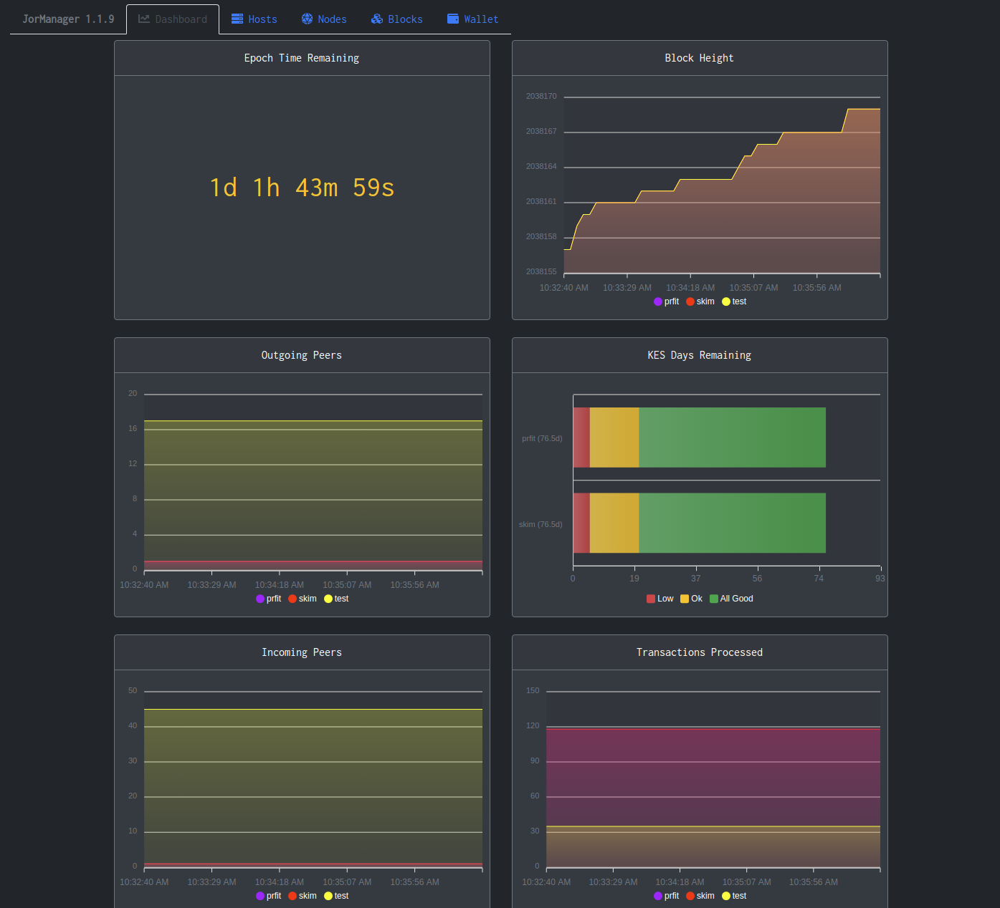
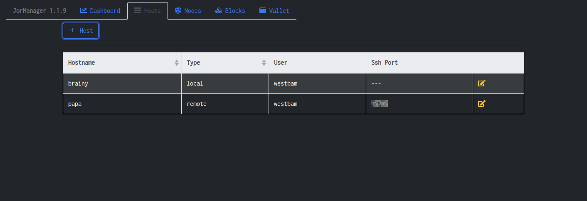
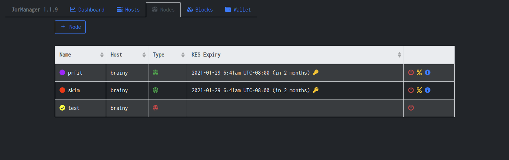
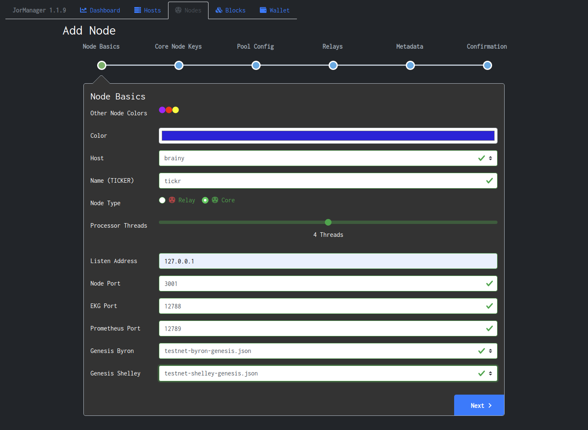
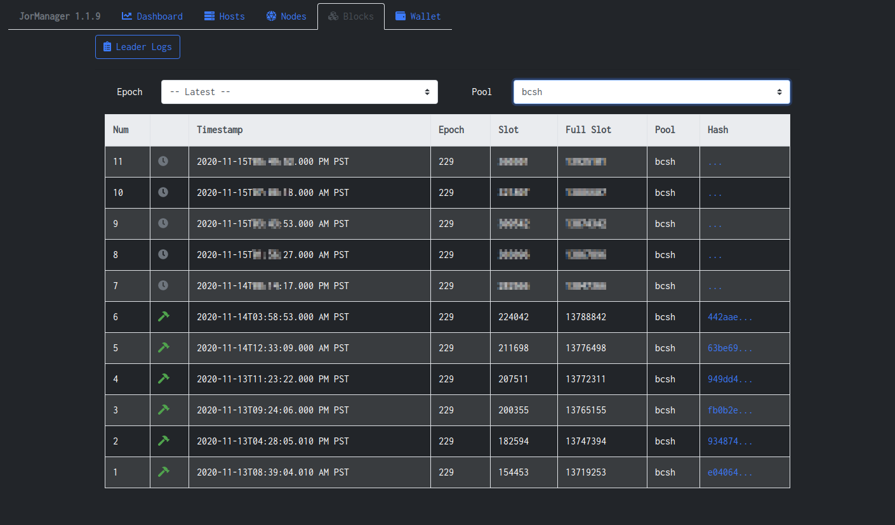
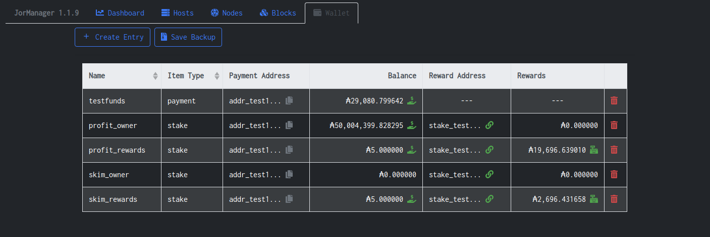
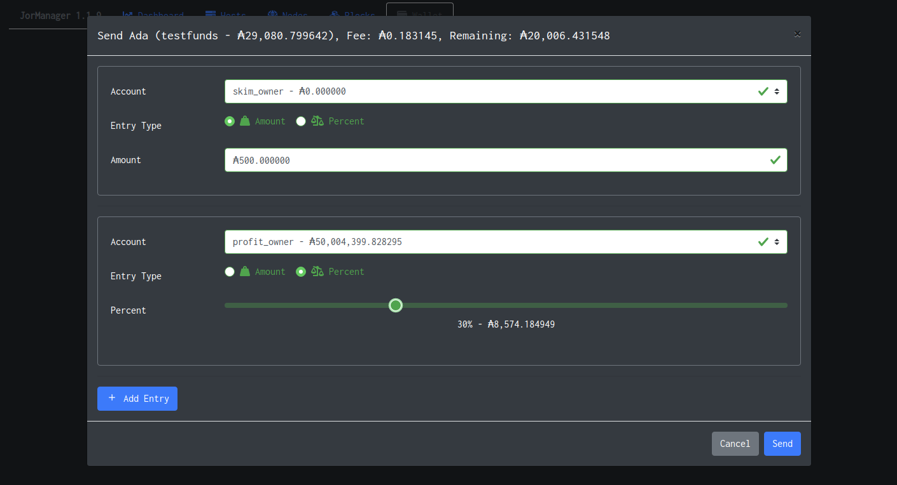
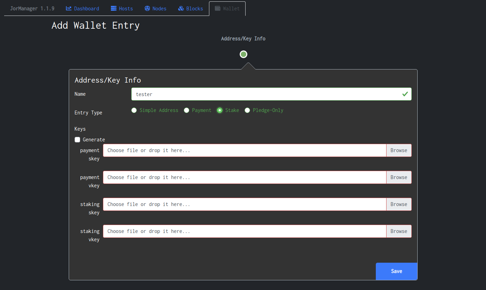

# JorManager

JorManager is a GUI-based Cardano stakepool management system. 

## What can it do?

### Monitor nodes and keys on a pretty dashboard

### Create connections to remote hosts

### Restart nodes, Rotate KES Keys, Modify pool fees, Edit pool metadata 

### Create nodes

### Monitor and Validate blocks. Calculate upcoming blocks (leader logs).

### Manage Stakepool funds, claim rewards, perform complex transactions.

## Get Started

Head over to our Wiki site for how to install and configure JorManager.

[JorManager Wiki Home](https://bitbucket.org/muamw10/jormanager/wiki/Home)

### Dijkstra-aware implementation

The current implementation preserves supported Conway/earlier-era operation and enables Dijkstra-dependent workflows only from verified, node-observed current-era evidence. Musashi Dōjō is the Dijkstra integration baseline, not a replacement configuration for existing networks.

See the [Dijkstra upgrade and operator guide](docs/dijkstra-upgrade-guide.md) for individual network file selection, single-action wallet/pool workflows, parent/child `directDeposits`, replay and observation limits. **Manual network, migration/restore and producer validation remains pending; local builds are not release qualification.**

## Build & Tests

Backend and frontend checks are decoupled so backend verification runs directly without Node.js or rebuilding Vue assets:

- **Backend tests & formatting**:
  - `./gradlew test` runs the default Kotlin/JUnit backend test suite.
  - `./gradlew ktlintCheck` checks Kotlin and Gradle Kotlin DSL formatting (`./gradlew ktlintFormat` autofixes).
  - `./gradlew ktlintCheck test --continue` runs all backend checks without stopping on the first failure.
- **Frontend checks & tests** (requires Node.js >= 26):
  - `cd vue && npm ci` installs frontend dependencies.
  - `cd vue && npm run lint:check` runs ESLint (`npm run lint` autofixes).
  - `cd vue && npx vue-tsc --noEmit` runs Vue/TypeScript type-checking.
  - `cd vue && npm run test` runs Vitest unit tests with console output and writes JUnit XML and JSON reports to `build/reports/vue-tests/`.
- **Executable JAR (`bootJar`)**:
  - `./gradlew bootJar` builds Vue assets into `vue/dist` (via `buildVue`) and embeds them under `BOOT-INF/classes/static/` inside `build/libs/jormanager-<version>.jar` (pass `-PprebuiltFrontend=true` when `vue/dist` is already built, such as in CI).

To run an opt-in backend smoke test, set its flag to `true` and run `./gradlew test --rerun --tests '*TestClass'` with the class name from the table.

| Test class | Opt-in flag | External dependency or effect |
| --- | --- | --- |
| `SmashTest` | `JORMANAGER_RUN_SMASH_TESTS` | Queries public Cardano SMASH endpoints. |
| `LocalTailTest` | `JORMANAGER_RUN_LOCAL_TAIL_TEST` | Reads `/home/westbam/haskell/prfit/logs/node-*.json`. |
| `MetadataUploadTest` | `JORMANAGER_RUN_METADATA_UPLOAD_TEST` | Uploads `/home/westbam/haskell/bcsh.metadata.json` to S3. |

## Support

If you need support, the ask for help on this telegram channel -> https://t.me/jormanager

#### Project Support

This project is designed to do nothing more than help out the Cardano community and ecosystem. It's offered without charge and **without warranty** of any kind.