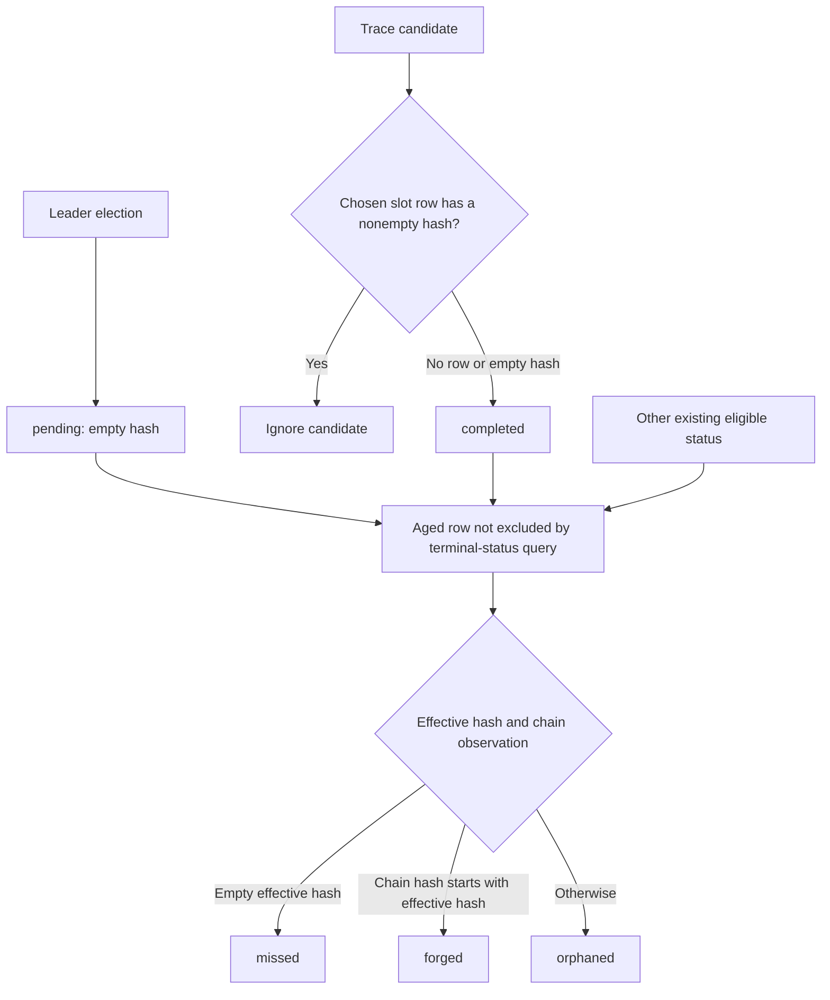

# Block adjudication

**Proposed design — not implemented or approved.** An explicit enum and a small classification function are worthwhile for the implicit lifecycle of operator-facing leader/trace block rows. This is not the chain sync or block-fetch wire state, nor is this table a consensus ledger. See [chain synchronization](chain-synchronization.md) and [fetch validity](block-fetch-validity.md).

## Existing data and writers

[`Block`](../../src/main/kotlin/com/swiftmako/jormanager/entities/Block.kt#L12) stores `slot`, `pool`, `host`, a possibly empty `hash`, and a free-form status string. It has no network key. Its documented strings are `pending`, `completed`, `missed`, `forged`, `orphaned`. The initial schema created `blocks` ([migration](../../src/main/resources/db/changelog/001-create-initial-schema.xml#L128)); later migrations explicitly dropped uniqueness on [slot](../../src/main/resources/db/changelog/016-update-blocks-schema.xml#L5) and [hash](../../src/main/resources/db/changelog/018-update-blocks-schema.xml#L5), and added nonunique indexes ([migration](../../src/main/resources/db/changelog/027-update-blocks-schema.xml#L5)). `findBySlot` orders by hash, not pool or network; `findByPoolAndSlot` returns one row ([repository](../../src/main/kotlin/com/swiftmako/jormanager/repositories/BlockRepository.kt#L19)). Multiple rows and ambiguous first matches are possible; neither slot nor a hash prefix establishes a globally unique network identity.

All current write paths matter:

* [`BlockController` leader calculation](../../src/main/kotlin/com/swiftmako/jormanager/controllers/BlockController.kt#L410) selects an elected slot, searches by pool name and slot then falls back to first row by slot, and inserts `pending` with empty hash only when neither exists. Its local mutex serializes its calculation writes, not all writers or application processes. Multiple elected pools at the same slot can be suppressed by that slot fallback.
* [`TracingBlockPersistenceService`](../../src/main/kotlin/com/swiftmako/jormanager/tracing/TracingBlockPersistenceService.kt#L32) creates a candidate using the event's host, slot, hash and status. [`TraceForwardProtocol2Extractor`](../../src/main/kotlin/com/swiftmako/jormanager/tracing/TraceForwardProtocol2Extractor.kt#L200) maps accepted forged/adopted trace events to `completed`. Under its own mutex the persistence service chooses the first row at that slot; if it already has a nonempty hash the candidate is ignored, otherwise it overwrites that row while preserving its id and pool, or creates a row. Trace observation does not itself establish chain adoption. Its mutex is separate from leader-log and monitor writes and cannot serialize other processes.
* [`BlockMonitor`](../../src/main/kotlin/com/swiftmako/jormanager/monitors/BlockMonitor.kt#L78) periodically queries rows older than synced tip minus 180 slots, excluding `missed`, `forged`, and `orphaned`. It obtains a chain row by slot and the known pool IDs. If the chain row belongs to a known pool it uses its hash, falling back to the candidate hash; otherwise it uses the candidate hash. It replaces the pool with the resolved node name if available. Empty effective hash yields `missed`; otherwise `chainBlock.hash.startsWith(effectiveHash)` yields `forged` and stores the full chain hash; everything else yields `orphaned`. It emits a `block` message after each save. These rules include the case of no chain row: empty hash is missed, nonempty hash is orphaned. They are current heuristics, not a claim that lack of observation proves a consensus fact.
* [`BlockController.getBlocks`](../../src/main/kotlin/com/swiftmako/jormanager/controllers/BlockController.kt#L169) also saves epoch/slot-in-epoch repairs for epochless rows; it should not independently change status or hash, but its read-copy-save may race another writer. Any cutover must preserve this path as well.

The chain table used by the monitor is the legacy header view, populated on the default-network chain-sync path ([source](../../src/main/kotlin/com/swiftmako/jormanager/nodeclient/protocols/chainsync/ChainSyncProtocol.kt#L239)); its slot lookup is not the per-network durable inclusion model. Do not claim that this operator-facing classification has the same guarantees as the ledger projection.

## Proposed type and rules

Use an enum because status variants have no intrinsically different required persisted payload; status and hash are intentionally composed, not an inferred one-to-one pairing. A `completed` trace normally brings a hash, but historical or concurrent data must not be silently reinterpreted. `forged` normally stores the chain's full hash, `missed` normally has an empty effective hash, and `orphaned` retains the candidate hash. The existing known-pool chain hash substitution can classify a previously empty-hash pending row as forged. Encoding `Pending` as necessarily hashless or `Orphaned` as necessarily holding a particular chain hash would misrepresent existing data. For a future richer evidence model, sealed types would be justified only if each alternative genuinely owns different mandatory evidence.

```kotlin
private enum class BlockStatus { PENDING, COMPLETED, MISSED, FORGED, ORPHANED }

// Illustrative: explicit conversion preserves existing lower-case DB/JSON values.
private fun BlockStatus.wireValue(): String = when (this) {
    BlockStatus.PENDING -> "pending"
    BlockStatus.COMPLETED -> "completed"
    BlockStatus.MISSED -> "missed"
    BlockStatus.FORGED -> "forged"
    BlockStatus.ORPHANED -> "orphaned"
}
```

Use the inverse explicit mapping at the persistence/transition boundary. Unknown existing values must be surfaced as data requiring inspection rather than guessed into an enum or discarded; the current query excludes three terminal strings but otherwise includes unknown values. A representation-only migration must account for them before stricter parsing. Preserve external `Block.status` spelling and existing WebSocket/API shape through a single mapping, not a compatibility shim or changed serializer accident.

Keep the decision pure and local to monitoring: pass the candidate, chain observation and pool lookup results; return updated hash, pool and enum status. Preserve branch ordering and `startsWith` direction exactly. The transaction/service that owns persistence applies that result only to the row/evidence version it read. The classifier makes the following transition boundary clear:



The three classifications are terminal **for the monitor's current selection query**, not proven irreversible under chain reorganizations or a universal prohibition on other writers. In particular tracing can overwrite a chosen row with an empty hash regardless of its status; do not invent a stronger transition guard while documenting the current code. The default-network header rollback path and the block monitor are distinct; current terminal selection does not automatically re-adjudicate rows on reorg. A new policy to reopen classifications, retain evidence or emit corrections needs an explicit product decision and tests, rather than quietly treating `forged` as final consensus or changing existing behavior.

## Concurrency, identity and recovery

Read/modify/save of a JPA data class can lose another writer's status/hash/epoch update. The three independent local mutexes (where present) do not protect across services or processes; monitor and repair paths can race with tracing. A proposed implementation should use a short DB transaction with a row lock or version-checked conditional update, reload the current row, and re-evaluate eligibility and evidence before writing. An optimistic failure must re-read and recompute rather than replay a stale copy. Emit only the committed saved row; WebSocket messages are observations and can be lost or reordered, so clients reload the blocks list after reconnect. A crash before commit must not leave a partial row update; after commit a missed notification is recovered by reading the database.

Row locking solves lost updates to an existing row, not races between concurrent inserts or ambiguous slot identity. Existing schema allows duplicates and the current lookup deliberately selects by slot. Do not add a uniqueness constraint on slot or hash: it would discard legitimate historical alternatives and still fail to distinguish networks. A stronger design requires a separately approved identity migration: establish a trustworthy network identity from source/genesis, separate election/pool and observed candidate identities, define ambiguous historical row handling and duplicate resolution, and coordinate every writer/query/UI. Existing rows cannot safely be assigned a network by guessing from current default configuration. Until then preserve current behavior and explicitly document that row-level serialization cannot fix cross-network or same-slot ambiguity.

## Migration and behavior tests

1. Audit existing statuses and duplicate slots before introducing strict enum mapping; resolve unknown records explicitly. Keep the existing columns, status strings, query predicates and `block`/`blocks` payloads. No schema change is needed merely for an enum and pure classifier.
2. Migrate monitor classification, tracing event mapping/persistence, leader-log insertion and epoch repair together. Use existing repository/JPA transactions and a targeted lock/version strategy for existing rows; do not wrap all work in a global in-memory mutex. Account for the different paths' side effects and after-commit notifications. If insert deduplication cannot be made safe without deciding identity, retain current semantics and expose the limitation rather than fabricate a key.
3. Extend [`BlockMonitorTest`](../../src/test/kotlin/com/swiftmako/jormanager/monitors/BlockMonitorTest.kt#L40), [`BlockControllerLeaderLogsTest`](../../src/test/kotlin/com/swiftmako/jormanager/controllers/BlockControllerLeaderLogsTest.kt), and [`TracingBlockMessageSinkTest`](../../src/test/kotlin/com/swiftmako/jormanager/tracing/TracingBlockMessageSinkTest.kt). Cover empty candidate with known-pool chain hash, no chain row, prefix and mismatching hash, unrelated pool, null pool mapping, exact age boundary, terminal query exclusions, duplicate slot ordering, trace with existing empty/nonempty hash, and epoch repair preserving concurrently changed classification.
4. Use transactional concurrency tests for tracing versus monitor/leader and epoch repair, including two processes or independent transactions. Verify no lost update, no double notification for a single committed update, and recovery after crash between commit and message. Test restart and reorg against the **existing** terminal-selection behavior; do not assert an unimplemented reclassification policy.

**Risks and rejected scope.** Hash prefixes and slot-only matching are heuristic; network/pool ambiguity and non-atomic cross-writer inserts remain until identity policy changes. Avoid generic FSMs, sealed payload hierarchies that impose false invariants, forced uniqueness, automatic reorg correction, and turning a UI event into durable authority.
