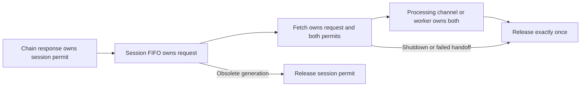

# Block fetch validity and ownership

**Proposed design — not implemented or approved.** Make the implicit ownership and generation validity rules explicit in the existing bounded fetch pipeline, rather than adding a per-block FSM framework. This is not the wire machine: [`BlockFetchProtocol.State`](../../src/main/kotlin/com/swiftmako/jormanager/nodeclient/protocols/blockfetch/BlockFetchProtocol.kt#L36) already models `Idle`, `Busy`, `Streaming`, `Done` and protocol agency. The relevant implicit lifecycle crosses chain sync, queues, wire response, worker, and the durable generation fence. See [chain synchronization](chain-synchronization.md).

## Current flow and invariants

[`NetworkChainSession`](../../src/main/kotlin/com/swiftmako/jormanager/nodeclient/protocols/NetworkChainSession.kt#L16) owns 128 permits and a 128-entry request channel. Each queued `Request` carries a point and generation. Chain sync reserves before `MsgRequestNext`; a roll-forward queues the point, a rollback releases that reservation after performing rollback, and a send failure releases it ([source](../../src/main/kotlin/com/swiftmako/jormanager/nodeclient/protocols/chainsync/ChainSyncProtocol.kt#L155)). `next()` discards queued requests whose generation is no longer current and releases their session permits. `MsgAwaitReply` is not a completed request and must not release its reservation.

The fetcher adds two permits and a one-item processing channel, with one worker ([source](../../src/main/kotlin/com/swiftmako/jormanager/nodeclient/protocols/blockfetch/BlockFetchProtocol.kt#L46)). It acquires a fetch permit before receiving a session request, sends a singleton range, and transfers ownership from `current` to the channel on `NoBlocks` or `BatchDone`. A response contains at most one block; a stale generation is not decoded as a current block. The worker processes sequentially, preserves adoption order and releases both permits in `finally`. Channel undelivered elements release both; a failed transfer releases both; shutdown takes and releases an in-flight `current`, cancels the channel and worker. `sendData` recycles a borrowed buffer and releases the permits it holds if handoff fails ([source](../../src/main/kotlin/com/swiftmako/jormanager/nodeclient/protocols/blockfetch/BlockFetchProtocol.kt#L64)).

The decode/save path resolves any certified Leios closure against its adopted predecessor, verifies cancellation, and calls coordinator `adopt` with the requested point and generation. Fetch failures for the current generation report a boundary failure; cancellation is normally propagated, with the particular active Leios acquisition cancellation handled as a boundary failure ([source](../../src/main/kotlin/com/swiftmako/jormanager/nodeclient/protocols/blockfetch/BlockFetchProtocol.kt#L163)). The authoritative check is inside the coordinator's transaction under the DB network lock, not the earlier volatile comparison. Decode, identity checks, predecessor, certificate and projection details are covered in [chain synchronization](chain-synchronization.md).

## Proposed ownership model

Retain the same capacities, `Channel`, semaphores, and request objects. Do not add a second per-block state machine. Instead, refine the **existing** protocol enum to expose its hidden streaming substate and replace `received`, while making ownership transfer a small set of named operations.

Illustrative replacement for the current wire state, not an additional parallel field:

```kotlin
private enum class State {
    Idle, AwaitingBatch, StreamingAwaitingBlock, StreamingReceived, Done
}

private fun State.agency(): Agency = when (this) {
    State.Idle -> Agency.Client
    State.AwaitingBatch,
    State.StreamingAwaitingBlock,
    State.StreamingReceived -> Agency.Server
    State.Done -> Agency.None
}
```

`MsgStartBatch` enters `StreamingAwaitingBlock`; accepting one block enters `StreamingReceived`. A second block is explicitly rejected in that state. `MsgBatchDone` before a block produces the existing empty-batch failure. The received substate records wire receipt, not successful decoding or current-generation validity: stale work can have no retained payload and must still be discarded/released correctly. Keep `current` and `pending` as private payload storage under `wireLock`, with invariants attached to each enum state; do not infer ownership from a nullable payload alone.

Use narrowly scoped `beginWire`, `takeCurrentForTransfer`, and `takeCurrentForShutdown` operations so payload/reset/state changes and transfer of release responsibility cannot be performed independently. These names describe proposed boundaries, not new public APIs. `takeCurrent` must atomically clear the owned request and associated payload; shutdown and response completion cannot both take it. Use exhaustive message/state handling for named protocol events and reject unknown wire IDs at decoding. This is explicit control state without a new object allocation per transition.

The cross-coroutine lifecycle remains ownership by location:



The *session permit* starts with successful `reserve`; ownership moves to the pending chain response, then the queued request, then fetch `current`, then processing channel/worker. The *fetch permit* starts with `permits.acquire`, remains with `sendData` until wire handoff, then accompanies that request to processing. They are released together only after both have been acquired. Before a request is received, send failure/cancellation releases just the fetch permit. After receive but before wire handoff it releases both. A stale queued item discarded by `next` releases only its session permit; the fetcher's already acquired permit stays with `sendData` while it waits for the next request.

The response side has exclusive wire ownership under `wireLock`. Shutdown can claim `current` once; transfer can claim it once; neither may release it after the other has claimed it. After successful transfer the channel owns both permits until the worker receives the item; `onUndeliveredElement` owns release only for an undelivered item, and worker `finally` owns it after receipt. Do not also release in the caller after successful `trySend`. Guard all payload state changes and `current` transfer consistently. A failure before a chain response is queued, cancellation while a deferred update owns a reservation, close with queued requests, and rollback throwing before the current release are important paths to audit: the design requires an explicit owner and exactly one cleanup for each, not an assumption that cancellation drains the queue. In particular `NetworkChainSession.close()` currently closes the channel, not an explicit permit-draining operation.

## Validity is not cancellation

A rollback/new session commits a new DB generation; older queued, in-flight, decoding or Leios work may still run. Local `session.generation` filters save work, but it can change after any check and is connection-local. Fence the final adoption under the coordinator's DB row lock; reject stale observations, failures and writes there. A new generation may race `transfer`, channel cancellation, decoding or a commit; if adoption acquired the row lock and committed first, rollback must subsequently reverse it; if rollback won, adoption must reject. Cancellation cannot promise either outcome and must not be presented as fencing.

Do not record `incomplete` from an old-generation failure after a rollback. `boundaryFailure` already compares generation under the row lock. Current worker errors propagate through supervision/mux shutdown (see [`workerFailureCancelsActualMuxWithoutAnotherHeader`](../../src/test/kotlin/com/swiftmako/jormanager/nodeclient/protocols/blockfetch/BlockFetchPipelineTest.kt#L190)); preserve this behavior rather than silently consuming malformed/unavailable blocks. A missing batch, invalid envelope, extra block, point mismatch, unavailable endorsed closure or projection exception is not successful adoption. Keep actual cancellation distinguished from an acquisition failure.

No conflated `StateFlow`/`SharedFlow` for block requests: every request and reservation has ownership and ordering. The existing agency flow signals a current wire state and is a different concern. Keep the bounded FIFO channel, singleton ranges, two in-flight/processing permits, buffer recycling, existing byte/span ownership and no additional per-block allocation or copy just to encode lifecycle. A sealed result may be useful only where it replaces the existing `Result<Pair<Int, ByteArray>>` and its success/failure payloads without increasing hot-path allocations; it is not needed merely to model permit states.

## Restart, migration and tests

A process crash loses in-memory requests and permits; PostgreSQL committed projection and generation remain authoritative. A new connection begins a fenced session, intersects with retained adopted complete history and re-fetches needed data; never persist an in-memory pending queue as ledger authority. A lost notification does not imply an uncommitted block. Follow coordinator recovery for out-of-history intersections.

For a future implementation, update `ChainSyncProtocol` reservation/deferred-update cleanup, `NetworkChainSession` enqueue/close/drain ownership, and `BlockFetchProtocol` send/transfer/shutdown/worker together, retaining the `MiniProtocol` agency interface and wire messages. Coordinate mux lifetime and tests; no API or DB schema change is required for ownership clarification. Do not alter payload decoding or replace channels with unbounded streams.

Extend [`BlockFetchPipelineTest`](../../src/test/kotlin/com/swiftmako/jormanager/nodeclient/protocols/blockfetch/BlockFetchPipelineTest.kt#L93) and [`ChainSyncResponsivenessTest`](../../src/test/kotlin/com/swiftmako/jormanager/nodeclient/protocols/ChainSyncResponsivenessTest.kt) with deterministic barriers:

* Saturate 128 reservations and two fetch permits; show producer backpressure and ordered adoption, then recover all permits.
* Cancel before/after acquire, queue receive, buffer borrow, wire handoff, transfer, worker receive, and during Leios acquisition. Verify each permit and buffer is released exactly once, including channel undelivered cleanup and shutdown racing transfer.
* Roll back with queued, current and worker-held requests, including after local generation check but before DB lock; assert no stale write or stale boundary error. Also test the opposite transaction ordering, where an already committed block is undone by rollback.
* Test roll-back exception/unknown target, pending deferred chain update, closed/full queue, no blocks, empty batch, malformed and duplicate block response, cancellation and restarted re-intersection. Assert queue closure leaves no retained reservation and failures terminate the actual supervised mux as intended.

**Risks and rejected scope.** Ownership depends on several existing asynchronous handoffs; the current code paths should be exercised rather than assumed leak-free. Avoid per-block lease objects, generic FSM infrastructure, new dependencies, unbounded prefetch and cancellation-as-fence. Any change in failure propagation or queue capacities is a separate behavior decision.
