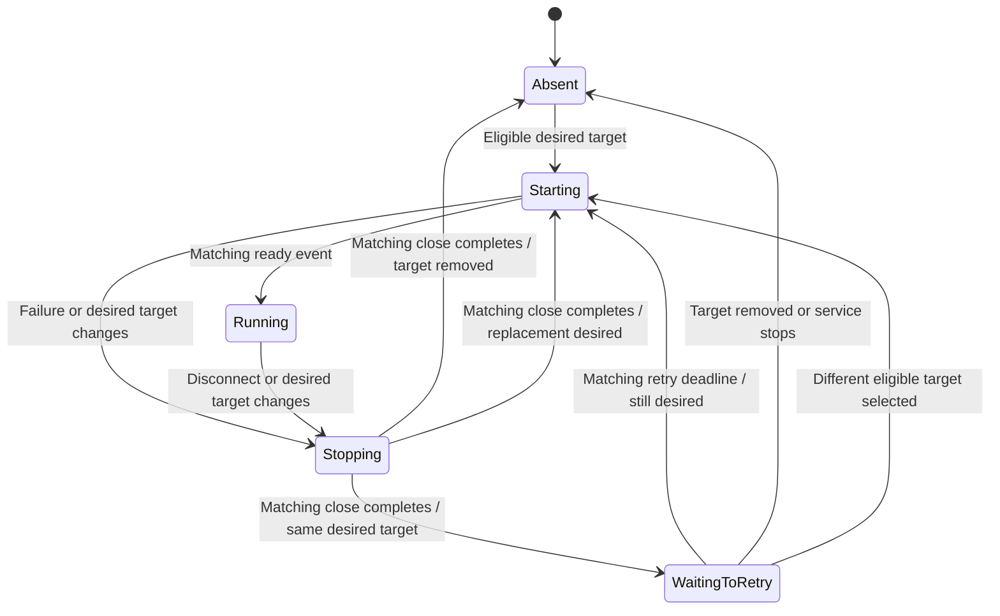

# Monitor and connection supervision

Status: **proposed design; not implemented**. This note covers the ninth backend machine family from the inventory. It does not propose changing wire-protocol state machines or the frontend.

## Recommendation

Make **worker ownership and service lifetime explicit**, starting with tracing and chain observation. Keep the sampling loops as ordinary structured coroutines. A lifecycle reducer is useful for replacement, retry, and shutdown; a framework that turns every metric or timer tick into an FSM event is not.

The important invariant is not merely “one active Job in a map.” It is **one authorized owner of a target's resources and current observations**, including while an old worker is being cancelled. A sealed lifecycle and serialized ownership transitions express that better than independent maps, flags, and nullable jobs.

Use a small, subsystem-local control loop with typed commands and a read-only `StateFlow` if observers actually need lifecycle snapshots. Do not introduce a generic supervisor DSL, a database table of live connections, or a new dependency.

## Current implementation and scope

### Tracing supervisor

[TracingConnectionManager](../../src/main/kotlin/com/swiftmako/jormanager/tracing/TracingConnectionManager.kt#L53) owns a `SupervisorJob`, a mutex, `managedConnections`, collector/seed jobs, and `isShuttingDown`. `isRunning` derives activity from several of those values.

`start` subscribes to node updates and seeds the repository. [`refreshNode`](../../src/main/kotlin/com/swiftmako/jormanager/tracing/TracingConnectionManager.kt#L131) resolves a target; ineligible targets remove/shut down a connection. An unchanged active target is retained. A changed target closes/cancels the old connection and installs a new runner/job. Replacement requests cancellation, but does not join the old job in this method.

The [connection loop](../../src/main/kotlin/com/swiftmako/jormanager/tracing/TracingConnectionManager.kt#L181) runs a connection, clears current capture on termination, delays five seconds, and retries while the target is still managed and shutdown is false. `shouldKeepRunning` compares target values, not a distinct attempt identity. Final cleanup also clears capture and closes the runner. `stopAndWait` removes ownership, shuts down runners, joins jobs, and cancels children.

The [transport runner](../../src/main/kotlin/com/swiftmako/jormanager/tracing/TraceForwardConnectionRunner.kt#L64) owns socket/mux/protocol collectors and selector cleanup. It only exposes `runConnection` and `close`; the manager currently does not receive a precise “handshake complete” event. Therefore a future `Connected` phase must either add a real transport-ready callback or be called `Running`, not inferred from job creation.

[TracingRawCaptureService](../../src/main/kotlin/com/swiftmako/jormanager/tracing/TracingRawCaptureService.kt#L54) indexes current snapshots by node ID. Its callback does not carry a connection attempt identity. This creates a replacement-ordering question: old callbacks/finalizers and a new worker can address the same node. That is a source-level concurrency risk to design and test, not a reproduced defect in this documentation task.

### Other family members

- [NodeMonitor](../../src/main/kotlin/com/swiftmako/jormanager/monitors/NodeMonitor.kt#L77) uses a job map and shutdown flag. [`refreshNode`](../../src/main/kotlin/com/swiftmako/jormanager/monitors/NodeMonitor.kt#L221) cancels/replaces sampling jobs. Sampling re-reads the node and emits null-valued stats on observation failure rather than claiming the node stopped. Its root job is cancelled on callback-based stop, unlike tracing's reusable root; direct `stop()` is empty.
- [ChainMonitor](../../src/main/kotlin/com/swiftmako/jormanager/monitors/ChainMonitor.kt#L54) creates a fresh root on start. Every ten seconds it chooses one nondeleted, nondraft node per network, preferring a default, and reconciles observer jobs. It joins removed observers before replacement. Its observer loop creates a new durable generation, opens a connection, and retries after ten seconds. Durable authority belongs to [chain synchronization](chain-synchronization.md), not this connection lifecycle.
- [PooltoolMonitor](../../src/main/kotlin/com/swiftmako/jormanager/monitors/PooltoolMonitor.kt#L105) owns per-node jobs but a class-level `mux`. Local reconnect and remote SSH-forwarding retry are separate nested loops; `retry` and nullable acquired resources encode their phases. A future owner must keep each worker's mux, SSH loan, and forwarding socket in that worker's scope.

Eligibility is not currently identical: NodeMonitor and PooltoolMonitor return early for drafts, ChainMonitor filters them during selection, and tracing's `resolveTarget` checks deletion/type/port/network/host without an explicit draft check. Do not silently claim one shared eligibility policy already exists. Agree the desired draft behavior and cover it before consolidating rules.

## Proposed lifecycle boundaries

Separate three concepts:

1. **Service lifetime:** stopped, running, stopping. Starting a new lifetime allocates a new owned coroutine scope; a cancelled `Job` cannot be reused. Both Spring stop entry points invoke the same shutdown path.
2. **Desired target:** latest eligible configuration, or absence with a reason. This may change while the previous worker is stopping. A new event replaces desired configuration, not an in-progress close operation.
3. **Worker phase:** starting/running, retry delay, stopping, or absent. Every phase associated with resources has a unique lifetime/attempt token. Configuration equality alone is not worker identity.

These are orthogonal facts, not a combinatorial sealed class containing every possible service/target/socket combination. Preserve subsystem-specific selection: node ID for tracing/sampling, network key for chain observers.

### Kotlin representation

Illustrative type shape only; the names below are proposed domain types, not existing APIs:

```kotlin
@JvmInline
value class AttemptId(val value: Long)

sealed interface WorkerPhase {
    data object Absent : WorkerPhase
    data class Starting(val attempt: AttemptId) : WorkerPhase
    data class Running(val attempt: AttemptId) : WorkerPhase
    data class WaitingToRetry(
        val previous: AttemptId,
        val retryAtNanos: Long,
        val reason: String,
    ) : WorkerPhase
    data class Stopping(val attempt: AttemptId) : WorkerPhase
}

sealed interface WorkerEvent {
    data class Ready(val attempt: AttemptId) : WorkerEvent
    data class Ended(val attempt: AttemptId, val reason: String) : WorkerEvent
    data class RetryDue(val previous: AttemptId) : WorkerEvent
    data class Closed(val attempt: AttemptId) : WorkerEvent
}
```

The controller separately holds the latest desired target and the resource-owning session handle. Exhaustive `when` expressions select the valid phase for each event; invalid/stale attempt events have an explicit discard path, not a catch-all that silently accepts new variants. A `Ready` event is only emitted at an actual ready boundary. For the sampling worker, successful launch into its sampling loop is the relevant boundary, not receipt of the first metric.

Resource handles stay private to the owner. Public lifecycle snapshots contain immutable IDs, phases, and sanitized reasons, never sockets, `Job`s, credentials, or exception objects. Do not store duplicated mutable phase on both the handle and snapshot: publish a projection after the owner's transition.

### Worker transition structure

This is the **proposed** per-target machine. Service stop or an ineligible desired target also prevents new starts.



If close cannot finish, remain `Stopping` and expose the reason. Do not report `Absent` or start a conflicting replacement merely because a timeout elapsed. A bounded shutdown timeout can fail/report shutdown; it is not proof that resources were released. Explicit close must unblock socket/forwarding I/O where cancellation alone does not.

## Ownership, effects, and concurrency

A bounded `Channel` carries control commands to one owning coroutine; use an ordinary receive loop rather than a new actor framework. Node updates become “reconcile this key” requests that load the latest repository state, avoiding stale seed snapshots overriding newer notifications. Preserve periodic repository reconciliation where already present. If keys are coalesced, use a keyed dirty set with a guaranteed drain; conflating arbitrary node events into a single latest event loses updates for other nodes.

The owner makes decisions without doing blocking connect/close/SSH work. Supervised child tasks acquire/close resources and report typed completions carrying the attempt ID. A `Stopping` worker retains ownership until its matching completion. This keeps a slow close for one node from blocking all other nodes' lifecycle decisions. Stop completion is acknowledged only after all owned workers and control producers have terminated; the event receiver must remain alive to accept their final completions.

A replacement is admitted only after the previous worker has closed and joined. Retire the previous observation token before cancellation. For raw current snapshots, token validation and mutation/clear must be serialized in the sink's per-node owner entry; a separate `if (isCurrent)` followed by an unguarded write has a race. Old `clearNode` calls must not erase a newer attempt's snapshots. Tokens need not allocate a wrapper per metric: capture the attempt in the connection callback and compare it at the existing snapshot-write boundary.

Trace block observations already committed to storage are historical facts, not ephemeral current snapshots. Do not delete them on transport retirement. Their source identity must remain attached to processing; the [block adjudication](block-adjudication.md) policy governs their interpretation. Keep expensive block persistence off the lifecycle command loop.

Cancellation is control flow, not a connection failure to retry. Re-throw `CancellationException`; let the owner decide retries only after matching termination. Retry schedules remain the current fixed policies initially. Exponential backoff, circuit breakers, automatic host repair, and health inference from missing samples are separate behavior changes, not prerequisites for explicit state.

For chain observation, an in-memory attempt token is not a replacement for the coordinator's persisted generation. Old socket work must still fail the durable generation check at ledger mutation. Closing a connection does not certify that its transaction outcome or chain view is current.

## Flows and DSLs

A read-only `StateFlow` is suitable for the latest immutable service/worker status, if consumed. Its conflation is acceptable for display, not command delivery or resource teardown. Collecting it must not start additional sockets. `stateIn`/`shareIn` are not a substitute for explicit ownership of side-effecting sessions.

`collectLatest` on the entire node-event stream is wrong: an update for node B would cancel node A's work. A keyed target flow could model replacement, but it still needs exact teardown, readiness, completion, and token rules. The small control loop makes those rules visible without layering a custom flow DSL on top.

Do not model every retry delay or protocol message as an allocated generic effect object. Lifecycle events are low-frequency; telemetry stays on its existing data path. Adopt a shared helper only after two migrated supervisors demonstrably have identical semantics. Chain selection, node sampling, tracing transport, and Pooltool forwarding do not currently share those semantics.

## Persistence and restart

Live sockets/jobs are process-local and should not be persisted. On restart, reconstruct desired workers from node/host/configuration repositories. Start new attempt identities and clear/revalidate current snapshots; do not deserialize a previous `Running` label as evidence of a live connection.

A deliberate Spring stop/start cycle must create a new service scope, reseed desired targets, and install a single collector. Define `isRunning` as the lifecycle controller accepting work, not whether any particular node is online. Individual worker status answers connection health. Shutdown callback invocation must be exactly once for each stop request after the agreed termination boundary.

No changes to chain, qualification, or authorized-operation durable state are implied by a tracing restart. Those authorities retain their own recovery rules.

## Migration surface

1. Start with `TracingConnectionManager`, its runner factory/interface, and the capture service. Introduce private lifecycle/attempt types and one owning control loop. Retain existing public startup, node-event, and snapshot APIs unless adding attempt identity at an internal sink boundary.
2. Update all runner implementations and test runners together if adding a ready callback. Make explicit whether readiness is TCP connected, handshake accepted, or protocol collection started; prefer handshake accepted plus collectors ready.
3. Make both stop overloads share one completion-aware shutdown implementation. Cover start/start, stop/stop, and stop/start before migrating another monitor.
4. Migrate `NodeMonitor`, `ChainMonitor`, and `PooltoolMonitor` independently, preserving their actual selection, delays, and observation semantics. Make per-worker resources local and remove obsolete flag/job paths during each cutover. Do not keep two authorities for worker ownership.
5. Leave WebSocket payloads unchanged unless lifecycle status is separately requested as a feature. An internal `StateFlow` does not require a new endpoint. No database migration is needed for process-local phases; the durable chain generation remains unchanged.

## Verification required before implementation is accepted

Existing coverage includes [TracingConnectionManagerTest](../../src/test/kotlin/com/swiftmako/jormanager/tracing/TracingConnectionManagerTest.kt) and [NodeMonitorTest](../../src/test/kotlin/com/swiftmako/jormanager/monitors/NodeMonitorTest.kt). They cover startup seeding, reconnect, deletion, direct/callback stop, snapshot clearing, and sampling behavior; they were not executed for this design note.

Add behavior checks for the ownership boundaries, not tests that only assert enum names:

- Repeated identical target notifications produce one session; changed configuration closes the old session before replacement becomes active.
- An old ready/end/retry callback cannot affect a newer attempt, even when target values are identical after removal/re-addition.
- Old snapshot writes/clears cannot overwrite/erase a new attempt's data. Previously committed historical block evidence remains intact.
- Stop during connect, retry delay, SSH forwarding setup, and message processing closes all owned resources, prevents retries, and acknowledges completion once.
- Failure to close keeps the key unavailable for conflicting replacement; unrelated keys continue to progress.
- A stale startup seed cannot undo deletion or a newer configuration update. Cover draft/type/port/default-network changes explicitly.
- A real loopback transport smoke scenario verifies handshake, disconnect, replacement, and socket closure; controlled fake runners alone cannot prove actual I/O interruption.
- Stop/start reseeds once with a new service scope; a cold lifecycle observer does not create additional transport connections.

## Cost and limits

This is worthwhile for the connection supervisors because replacement and shutdown have externally visible resource consequences. It is not worthwhile to turn each sampling loop or each explicit mini-protocol into another framework. Sealed types document legal ownership states; they do not make cancellation instantaneous, remote I/O reliable, or snapshot publication atomic without the owner/sink rules above.
