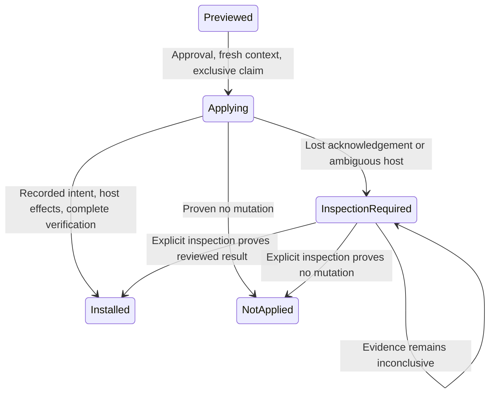

# Leios key installation: host observation, not chain adoption

**Status: proposed design, not implemented or approved.**

## Recommendation

Make installation attempts explicit because an SSH failure or crash can leave partially replaced credentials and startup configuration despite a `failed` or `installing` database status. Keep it a small service-local state model backed by durable records, with manual, evidence-based recovery; this is independent of the pool's chain key, and independent of what a running node has actually loaded. See [pool deployment](pool-deployment.md), [reviewed transactions](reviewed-transactions.md), and [capability qualification](capability-qualification.md).

## Existing lifecycle

[`LeiosInstallationService.context`](../../src/main/kotlin/com/swiftmako/jormanager/services/LeiosInstallationService.kt#L60) selects an undeleted, non-draft core or child pool and its core producer on the same host/network; the key must belong to the same pool/network and have a signing file. It requires current Dijkstra era evidence from the target and verified `leios.key.install` capability. It inspects the startup file, systemd service user, mode (bulk versus singleton), and hashes startup, environment, config and credential paths. A child requires bulk mode. This does **not** establish current chain adoption of the selected key.

[`preview`](../../src/main/kotlin/com/swiftmako/jormanager/services/LeiosInstallationService.kt#L97) inserts `previewed` or returns the same review for a matching request ID, target, fingerprint and key while still previewed. It reports the startup/credential path, expected backup, disruption and manual restart requirement. [`install`](../../src/main/kotlin/com/swiftmako/jormanager/services/LeiosInstallationService.kt#L115) checks approval and password, reloads context and preview, validates/decrypts the signing envelope, and uses a conditional update to claim `previewed → installing`. It then rechecks the fingerprint and derives a public key on the host to verify the private key against the selected public key.

Bulk mode reads and validates the credential array, identifies exactly one entry by the target pool's VRF secret, adds the key without removing an existing key, backs up the old content and replaces the credential through a staged adjacent rename. Singleton mode installs the key file and updates the startup argument, with a startup backup and systemd daemon-reload where appropriate. It checks the installed credential hash and `owner:600`; the success path writes a [`KeyInstallation`](../../src/main/kotlin/com/swiftmako/jormanager/entities/KeyInstallation.kt#L11) observation and marks the preview `installed` ([host effects](../../src/main/kotlin/com/swiftmako/jormanager/services/LeiosInstallationService.kt#L141), [completion](../../src/main/kotlin/com/swiftmako/jormanager/services/LeiosInstallationService.kt#L211)). It does not restart the producer, and returns `loadedFingerprint = null`: the qualified interface does not observe the actual loaded key. Notably, current final verification checks credential content/permissions, but does not independently re-read and verify the final singleton startup hash and service linkage. A caught exception writes `failed` and a sanitized failed installation observation; a process crash can leave `installing`, and DB writes and host effects are not atomic.

[`leios_install_previews`](../../src/main/resources/db/changelog/045-dijkstra-provisioning.xml#L51) has unique request ID but no per-producer in-flight uniqueness constraint. Consequently the claim protects one preview, not simultaneous different reviews for the same producer or collisions with pool deployment. `key_installations` is a host observation record; chain rollback must not rewrite it as if host files rolled back.

## Proposed explicit model

```kotlin
sealed interface InstallState {
    data object Previewed : InstallState
    data class Applying(val checkpoint: Checkpoint) : InstallState
    data class InspectionRequired(val checkpoint: Checkpoint, val reason: Reason) : InstallState
    data class Installed(val observation: InstalledEvidence) : InstallState
    data class NotApplied(val reason: Reason) : InstallState
}
enum class Checkpoint { CLAIMED, MUTATION_INTENT, HOST_VERIFIED }
```

These are illustrative domain types, not implemented code. The record keeps reviewed key/producer identities, fingerprint, nonsecret expected old/new content identities, paths, backups, owner/mode and checkpoint; it never persists passwords or plaintext secret material in the journal. Decode existing DB rows with strict evidence checks. Use exhaustive transition handling and conditional DB updates. The API explicitly maps these types to the current `previewed`, `installing`, `installed`, `failed` wire vocabulary, surfacing inspection as an uncertain failure with a sanitized reason; do not silently introduce a new wire enum.



A host observation is timestamped evidence, not permanent truth: an operator can change files later. It is not chain authorization, and `Installed` is not `Loaded`. Maintain separate chain observations and loaded observations, with `unknown` when unavailable; do not infer one from the other or roll back host evidence when chain history changes. A restart remains a separate operator action.

## Effect ownership and recovery

* The service claims a resource covering the **actual producer and affected startup/credential paths**, shared with child pool deployment and other installation attempts. Claim the specific preview atomically and revalidate era, capability, target, key and fingerprint after claiming. Different child node IDs can still share the same bulk file. A DB timeout or generation fence alone cannot stop an already-running SSH command: recovery must establish that the old worker and remote command are quiescent, or have a real host-side fencing protocol, before allowing a new mutator. If not provable, keep inspection required.
* Persist intent before the first host change, with stable protected staging/backup locations and expected prior/output hashes, including the whole bulk array and intended target entry. A command may run even when its SSH response is lost; no database checkpoint says atomically whether the remote operation happened. Compare preimage and intended output before every controlled replace and never overwrite unreviewed operator edits. Preserve other bulk entries and all existing keys. Avoid public disclosure of credentials, backup content or sensitive hashes.
* A crash before mutation may leave temporary verification keys or staging/backup files. Inspect and clean only known per-attempt paths under appropriate permissions, after proving no old command is in flight; an absent mutation plus an unchanged preimage can support `NotApplied`. Crash after backup or rename but before DB update can leave old, new, or mixed host state. Reconnect, inspect both credential and startup, environment/config linkage, service user, owner and mode, protected backups, selected key's verified public identity, and systemd configuration/reload as applicable. A credential hash alone is insufficient to prove startup points at it. Check that a bulk entry is the unique intended pool and that non-target content has not changed unexpectedly. Missing evidence, unreachable host or mismatches remain inspection, not `failed = safe to retry`.
* A fully matching intended host state may be recorded as installed after rechecking the approved target and policy, and atomically saving installation observation and final attempt state. If it is partial, any repair or rollback is a separately approved plan with fresh fingerprints, checks for concurrent changes and protected backups; do not blindly restore a backup over newer credentials. Re-observe after repair. If a host verification succeeds but the process dies before the DB transaction, repeat inspection and conditionally finalize; do not repeat mutation automatically. If commit succeeded before response loss, a repeated status query returns the durable result.
* Database claims and host filesystem mutation are not a distributed transaction. Deleting a staging file or cancelling a coroutine does not prove an SSH child has stopped. Secret staging, backups and temporary verification keys require restrictive permissions and a cleanup policy even on crash; never treat a cleanup failure as proof that the installation failed without effects.

## Migration and verification plan

1. Extend preview storage with checkpoint, protected recovery references and version/claim evidence; preserve existing request IDs and external result fields. Treat old `installing` **and** `failed` rows as requiring inspection unless there is affirmative proof of no effect. Do not fabricate `loadedFingerprint` or infer installed state from a lone row. Migrate `KeyInstallation` result/observation writes together with the preview finalization transaction and keep older observation history.
2. Update the Leios controller message handlers and result/error mapping, callers displaying installation/loaded/chain facts, and pool deployment's optional `KeyInstallation` write. Share only the minimal producer-resource claim and perhaps nonsecret inspection utilities with deployment; it has a different irreversible opcert/counter lifecycle and must not be shoehorned into an abstract framework. No in-memory `Flow` should become durable authority.
3. Exercise preview replay versus conflicting request; approval/password and stale key/era/capability/config failures; singleton manual/systemd and bulk child with exactly one VRF match, preserved other entries and duplicate key. Verify startup argument, daemon reload, mode/owner and public key derivation, with no automatic restart or claimed loaded key. Race two previews and a deployment sharing a producer. Inject crash or lost acknowledgement before/after verification staging, backup, credential rename, startup replace, reload, host verification, observation insert and final commit; ensure recovery classifies absent, complete, partial, changed and unavailable host correctly without blind retries. Test chain rollback or key rotation separately from host facts and preserve legacy wire statuses.

**Risk / rejected scope:** Host inspection can be inconclusive and may require operator access; safety beats automatic recovery. No generic FSM framework, secret-bearing event log, automatic service restart, inferred chain adoption or assumed loaded-key telemetry is proposed.
