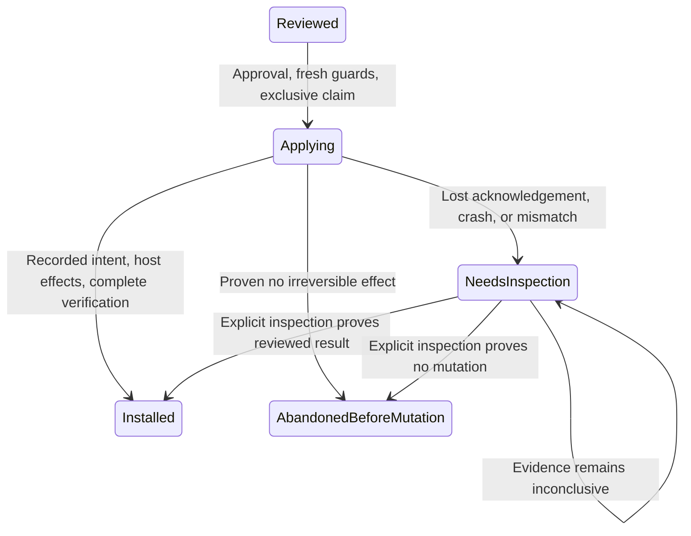

# Pool deployment: reviewed host mutation

**Status: proposed design, not implemented or approved.**

## Recommendation

Model deployment explicitly and durably. This operation issues an operational certificate, changes a producer host and only later updates the database; neither a Boolean draft flag nor `failed` captures partial side effects. The small machine belongs in `PoolDeploymentService`, with a durable recovery journal and explicit inspection. It should not own chain registration, key adoption or producer runtime status. See [reviewed transactions](reviewed-transactions.md) and [Leios key installation](leios-key-installation.md).

## Current behavior

[`PoolDeploymentController`](../../src/main/kotlin/com/swiftmako/jormanager/services/PoolDeploymentService.kt#L43) exposes review and install messages. [`context`](../../src/main/kotlin/com/swiftmako/jormanager/services/PoolDeploymentService.kt#L91) requires an undeleted draft core/pool, a live same-network observer with current Conway or Dijkstra era evidence, qualified capabilities, a validated configuration snapshot, a matching `confirmed` reviewed pool registration and an actual pool-state query. Dijkstra also requires the selected matching BLS key in current or future pool parameters. Parent pool deployments validate the active core and its files; singleton deployments require an unused folder/service and ports. Context fingerprints configuration, relevant DB files, existing host files and era generation. This is a point-in-time observation, not a lock on chain or host.

[`preview`](../../src/main/kotlin/com/swiftmako/jormanager/services/PoolDeploymentService.kt#L177) persists `previewed` and reports paths, mode and consequences. Unlike Leios preview, it inserts a new row even for a repeated request ID; the schema makes request ID unique. [`install`](../../src/main/kotlin/com/swiftmako/jormanager/services/PoolDeploymentService.kt#L189) checks approval, password and fresh matching context, decrypts keys, then atomically claims `previewed → installing`. The [schema](../../src/main/resources/db/changelog/045-dijkstra-provisioning.xml#L19) additionally allows only one `installing` preview per node, not per shared producer host. It rechecks the fingerprint after the claim.

The installer derives the BLS public key if present, writes temporary cold key/counter/KES verification key, runs `issue-op-cert`, saves the advanced counter and cert in database files, then installs singleton assets/credentials/startup or changes a parent to bulk credentials. Private files are checked for owner and mode `600` and their hash; startup/config and selected files are hash checked. Systemd changes run daemon-reload; existing parent startup gets a backup when converted to bulk. Parent credentials and selected identity are checked before modification. Finally it saves `isDraft=false` with the cert ID, optionally records a `KeyInstallation`, marks preview `installed`, emits the node, and returns loaded fingerprint null ([effects](../../src/main/kotlin/com/swiftmako/jormanager/services/PoolDeploymentService.kt#L204), [completion](../../src/main/kotlin/com/swiftmako/jormanager/services/PoolDeploymentService.kt#L310)). There is **no producer restart**. On caught exception it writes `failed` and asks for host/counter inspection; a crash may leave `installing`. These separate writes are not one database/SSH transaction.

## Proposed states and ownership

A sealed projection over a persisted attempt, not a generic framework:

```kotlin
sealed interface DeploymentState {
    data object Reviewed : DeploymentState
    data class Applying(val checkpoint: Checkpoint) : DeploymentState
    data class NeedsInspection(val lastCheckpoint: Checkpoint, val reason: Reason) : DeploymentState
    data class Installed(val evidence: HostEvidence) : DeploymentState
    data class AbandonedBeforeMutation(val reason: Reason) : DeploymentState
}
enum class Checkpoint { CLAIMED, CERTIFICATE_INTENT, CERTIFICATE_RECORDED, HOST_MUTATION_INTENT, HOST_VERIFIED }
```

The persisted attempt records approved target/parent, snapshot and era/capability/registration evidence, planned paths, expected nonsecret hashes and owner/modes, checkpoint and known counter/certificate identity. It must not store passwords or plaintext keys in its journal or logs. `HostEvidence` identifies exactly what was verified and when; `Installed` does not assert a running producer or loaded key. A decoder rejects missing evidence rather than constructing a success from nullable fields. An exhaustive transition function and conditional database updates enforce the graph:



The arrows are guarded domain operations, not promises that checkpoint writes and SSH are atomic. `NeedsInspection → Installed` requires all reviewed outputs and current policy to be verified; an operator-directed repair is a new reviewed action with explicit scope, not an implicit restart of the old attempt. An irreversible certificate issue may have happened even if no output is found. Preserve the current external `previewed`, `installing`, `installed`, `failed` vocabulary via an explicit endpoint mapping: inspection maps to the existing failure/uncertain response with a reason, and pre-mutation abandonment to failure. Internally distinguish failure before a host effect from an unknown outcome. Never use the notification flow as command authority.

## Certificate and crash recovery

1. Claim in PostgreSQL with an attempt ID and serialize conflicting operations by **producer host and actual credential/startup resource**, including child deployments and separate key installs, not just the node ID. A DB lease that expires cannot fence an SSH command already in flight. Require the old worker/session to be positively stopped or a host-side fencing mechanism before another writer mutates the same resources; generation numbers only reject stale DB commits. If that cannot be established, remain in inspection.
2. Revalidate review and registration/chain/capability guards immediately before mutation. Serialize issuance by cold key/counter identity as well as producer. Persist `CERTIFICATE_INTENT`, input counter identity and a stable private remote work location before calling the CLI. Protect the location and staged keys; never put private material in an event log. The issuer increments the counter: it is not safe to restore an old counter or blindly reissue after lost SSH acknowledgement. Exact counter semantics must be verified with the actual CLI and recovered artifacts.
3. Crash before issue: inspect the saved intent and work location, confirm no command remains in flight and no issuance/counter advance occurred before declaring pre-mutation abandonment. Crash during/after issue but before reading or saving outputs: inspect staged counter/certificate, verify their relationship to the cold key, KES key, period and prior counter, and compare authoritative counter copies. Persist the recovered counter and cert only when provenance and monotonicity are provable. If missing, contradictory or another issuer may have acted, stop for operator/cold-key counter reconciliation; do not reconstruct an assumed counter or overwrite a newer one. If certificate/counter persistence is split, reconcile both, never infer the second from the first.
4. Before each host mutation record its intent and expected old/new nonsecret fingerprints, including bulk entries and startup/config; retain protected backups and per-attempt staging paths. A crash can occur after any file write, permission change, backup, rename or daemon-reload but before its checkpoint. On reconnect inspect folder, assets, private-file identity via safe on-host checks, owner/mode, service user, startup arguments, environment, credentials and daemon-reload status. Compare actual state to both reviewed preimage and intended output. Neither an old checkpoint nor a hash alone proves every step happened. Never expose secret bytes or secret-derived material in public results.
5. If everything matches the reviewed output, verify configuration linkage, ports/parent and permissions and commit certificate reference, `isDraft=false`, key observation and final attempt state in one short DB transaction guarded by attempt generation and the expected draft/version. If absent and no side effect is provably possible, abandon; partial/mixed/unreachable host or mismatched backup stays inspection. Restoration or completion requires a separately authorized, conflict-checked plan; never blindly overwrite changes made by an operator. Host verification and DB commit still have a crash window, so recovery repeats observation and conditional commit, not host mutation.

The above is a proposed protocol, not a claim that existing temporary paths, backups or checkpoints already provide it. Even a previously confirmed registration can roll back during deployment: recheck before mutation and finalization; if it changes after mutation, retain host facts and surface chain status separately. A rollback cannot undo an issued certificate or uninstall files.

## Migration and behavior checks

* Add a migration for attempt checkpoints, evidence and conflict ownership; inventory stranded `installing` and existing `failed` records as **inspection required**, not safe retries. Preserve unique request semantics, `isDraft`, certificate file IDs and existing result status mapping. Recovery must support legacy rows with no journal by conservative host/counter inspection. Avoid assuming `failed` means no effect.
* Update both controller operations, `Node` persistence, node notification consumers, reviewed registration lookup and optional `KeyInstallation` writes. Atomically finalize DB records; make repeated status requests read the durable attempt. Do not automatically start/restart the producer. Coordinate resource claims with Leios installation on the same producer; reuse a narrow resource-claim or inspection primitive only if both truly share it, not a generic deployment DSL.
* Verify success for singleton/manual/systemd and bulk parent, Conway and Dijkstra, matching and mismatched pool-state/key; concurrent requests across children and key install; stale evidence or rolled-back registration; rejected passwords and credential ownership. Inject process death and lost SSH acknowledgements before/after issue, counter save, cert save, every host change, reload, host verification and DB finalization. Verify no counter reuse or blind retry, no overwriting external edits, secret cleanup/permissions, correct recovery after DB commit, and installed-but-not-loaded reporting.

**Risk / rejected scope:** Safe recovery depends on actual host observability, exclusive cold-key issuance and operator intervention where proof is unavailable. Do not add an event-sourcing system, background auto-retry, automatic restarts, or a general-purpose deployment framework.
