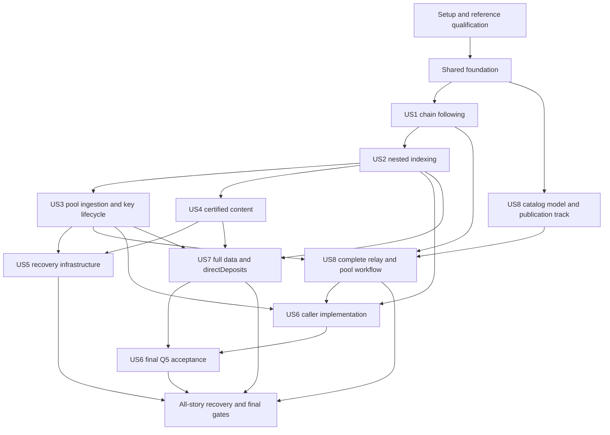

# Tasks: Dijkstra Era Support

**Input**: [plan.md](plan.md), [spec.md](spec.md), [research.md](research.md), [data-model.md](data-model.md), [contracts/](contracts/), and [quickstart.md](quickstart.md) in `specs/001-dijkstra-era-support/`.

**Governance**: [constitution](../../.specify/memory/constitution.md), version 1.1.2. Reuse the dated MCP consultation and concrete G0–G6 gates in the plan; do not label it a fresh consultation. Reassess through the mounted MCP tools when actual implementation risks change.

**Baseline**: Musashi Dōjō is the Dijkstra qualification baseline, not a replacement baseline for previously supported networks and eras. Existing Conway deployments and operations remain supported without Musashi-only configuration or credentials; do not restore the former independent Cardano pins. Exact upstream revisions/build/configuration hashes are evidence snapshots. Public Musashi starts Dijkstra at epoch zero; use independent standalone era and ordinary fault scenarios without orchestrating a hard fork.

**Tests**: included because FR-031/FR-032 and SC-001–SC-012 explicitly require independent valid/rejected/boundary comparisons and safe end-to-end evidence. Add the listed deterministic consumer-visible regressions before implementation and observe their failure for the missing behavior. Do not add wiring/source-text/mock-echo tests. Real GUI/node/CLI/SSH/PostgreSQL smoke remains mandatory; test compilation or documentation validation is not compatibility evidence.

**Organization**: all eight stories remain in scope. Phases order the P1 stories US1–US5 and US8 before P2 US6–US7 without renumbering story identities. Shared facilities precede all stories. US6 implementation precedes US7, while full US6 acceptance follows US7 integration and acceptance. US5 has a final all-story acceptance dependency because later integrations add state that must also survive recovery.

## Format and path conventions

Each task uses `- [ ] Tnnn [P?] [USn?] Description` with exact repository-relative file paths. IDs are sequential in the priority-ordered execution list; explicit dependency IDs define safe ready waves. `[P]` means an independent file set within its ready wave **after** its listed prerequisites are complete, not permission to ignore prerequisites. Unmarked tasks are serialized by their file owner. Story labels appear only in story phases.

Existing source locations were checked during generation. Named files that do not yet exist are **proposed new implementation/test/evidence files**, not claims of existing APIs or harnesses. Keep them in the existing package/test conventions; do not create a new service/framework. Evidence records named here are future outputs: store actual sanitized results, immutable fixture/capture digests and independent expected-versus-observed outcomes, never signing secrets or fabricated success. Reference manifests enumerate raw fixture files under `src/test/resources/dijkstra/`.

The migration name `src/main/resources/db/changelog/043-dijkstra-schema.xml` is the next free number observed at generation; recheck at implementation and change only the new filename/include if concurrent work consumes it. All schema/constraint registration has one owner. Data-model field/constraint quotations below are normative, including nullability, exact values, ownership, uniqueness, bounds and lifecycle dimensions; do not weaken them to pass tests.

## External prerequisites and completion rules

- **B1**: independently capture and exercise actual Musashi transport, era/header hashes, complete direct/certified closure/order and rollback. No invented EB-fetch protocol.
- **B2**: the supplied CLI 11.6.0.0 and `cardano-node-leios` 11.2.0.164 revision `746f1b3cbdaada2c3ed2f702b0946643248dd30b` are available qualification inputs. Local help exposes BLS registration and singleton/bulk startup flags. PR #6749 documents the per-pool bulk format; implement JorManager generation/loading and exercise proof/snapshot/producer behavior rather than wait for a missing upstream loader.
- **B3**: all eight Musashi catalog assets are now published and downloadable from `https://bluecheesestakehouse.com/jormanager/index.html`. The observed stable `musashi-*` aliases have no linked manifest or versioned filenames. T057 retains only completion/verification of the planned immutable publication contract; application snapshots, fifth-genesis/peer support and clean relay/pool qualification still remain. Publisher access is required only for further server changes, not current downloads.
- Record precise remaining prerequisites and owners, without reintroducing resolved availability blockers. Do not mark whole tasks complete from partial evidence or substitute mocks/manual imports. Open PR status does not prevent qualification of the supplied build; record build/source provenance and actual results without claiming an upstream merge. B3 still blocks provisioning acceptance/release, not unrelated local edits.
- Commands that spend disposable funds or write/restart managed hosts run only after explicit operator authorization. No production keys/funds/nodes are test inputs. Research and task generation themselves authorize no remote mutation.
- Run the focused regression and actual surface scenario at the appropriate integration checkpoint; full suites and final Q0–Q8 follow the completed cutover. Q8 uses independently established Conway and Dijkstra targets and controlled block observations/node responses in standalone app or contract cases, not hard-fork transition or cross-era rollback tests. Do not run formatters/builds repeatedly mid-edit or retry failed gates into a pass.

**Evidence update (2026-10-28):** [research section 7](research.md#qualification-update--2026-10-28) records user-supplied build facts, observed download digests/JSON/reference checks, help output and [PR #6749](https://github.com/IntersectMBO/cardano-node/pull/6749). Old local CLI diagnostics are historical. All original responsibilities remain unchecked because each includes work beyond these newly available prerequisites; T057's initial asset-publication portion is complete.

## Phase 1: Setup (Shared Qualification Inputs)

**Goal**: Reuse the existing Kotlin/Java 21/Spring/PostgreSQL/Liquibase/Vue stack; do not initialize a second application or restore independent Cardano pins. Assign the plan gate owners and prepare safe, independently reproducible inputs.

### Implementation

- [ ] T001 Record the published Musashi config snapshot and supplied CLI 11.6.0.0 / `cardano-node-leios` 11.2.0.164 build at `746f1b3cbdaada2c3ed2f702b0946643248dd30b`, including actual executable paths, component/binary hashes, five genesis identities, magic/system start, protocol settings and source/runtime distinctions. Record the independently supported Conway network/tool profile and its applicable configuration and observed era without imposing Musashi assets or versions on it. Resolve dependency differences from the older research candidate rather than imposing it on this build. Assign B1/B2/B3 and G1–G6 owners, review research section 12's dated MCP selection and reassess through MCP only if risks change. Files: `src/test/resources/dijkstra/runtime-manifest.json`, `specs/001-dijkstra-era-support/plan.md`. Dependencies: none.
- [ ] T002 Verify the checked-in exact ManifestV1 JSON Schema and synthetic serialization vector as the shared publisher/downloader contract; require schema format assertions and duplicate-key rejection, exact no-unknown wrapper {resetId,bundleId,payload} and payload {schemaVersion,identity,assets,retrievedAt,provenance}, HTTPS nonempty-host check without userinfo/fragments, RFC 8785 SHA-256 resetId(identity)/bundleId(payload), and existing catalog trust for provenance URLs. Retain the reproducible vector and reject divergent publisher/application schema or hash interpretations; it is serialization-only, not valid ledger genesis or runtime qualification. Files: `specs/001-dijkstra-era-support/contracts/network-configuration.schema.json`, `src/test/resources/dijkstra/network-manifest-v1-vector.json`. Dependencies: T001.
- [ ] T003 [P] Obtain independently generated raw fixtures and reference pre/post-state for every research section 8 family, at least 100 successful/script-failed/certified batches, parent/child output-zero identities, directDeposits, all envelope forms and rejected boundaries. Include independently sourced supported historical-era blocks and separate Conway/Dijkstra parameter and ordinary workflow cases; no orchestrated fork is needed. Record generator revisions, executable generation/replay commands, artifact digests, expected hashes and acceptance rule outcomes before implementing JorManager expectations; retain fixtures by their manifest paths and exclude secrets. Files: `src/test/resources/dijkstra/corpus-manifest.json`, `src/test/resources/dijkstra/reference-generation.md`. Dependencies: T001.
- [ ] T004 [P] Provision disposable PostgreSQL/app/SSH targets, a supported standalone Conway environment and public Musashi test resources plus a private same-bundle Dijkstra environment with controlled ordinary rollback/fault commands; capture actual environment and safety checks. The Conway environment must remain usable without Musashi assets or Leios credentials; the two networks must be usable concurrently for isolation checks. Reuse the published eight-file catalog; arrange publisher coordination only for the remaining immutable manifest/versioned assets, recording the real external deployment handoff without committing credentials or inventing a local server repository. Files: `specs/001-dijkstra-era-support/evidence/environment.md`, `specs/001-dijkstra-era-support/evidence/publication-handoff.md`. Dependencies: T001.
- [ ] T005 Execute reference-node/CLI qualification using the supplied upgraded executables on disposable targets: capture negotiated framing/era/header commitments, direct/certified acquisition/order, rollback, accepted submission forms, proof/registration/snapshot queries and actual loaded keys. Exercise PR #6749's per-pool embedded BLS envelope/array, ordering, mixed legacy entries and malformed-key rejection; distinguish upstream author-reported tests from this run. Help alone cannot clear B1/B2. No production signing/deployment. Files: `src/test/resources/dijkstra/delivery-manifest.json`, `src/test/resources/dijkstra/tool-capabilities.json`, `specs/001-dijkstra-era-support/evidence/reference-boundaries.md`. Dependencies: T003, T004.

## Phase 2: Foundational (Blocking Shared Infrastructure)

**Goal**: Complete these shared contracts and persistence facilities before story implementation. Use Exposed for the chain commit and existing JPA/File credential conventions for configuration; no mixed-transaction-manager atomicity assumption.

### Implementation

- [ ] T006 Implement an independent-fixture loader that verifies raw artifact/pre-state digests and exposes expected structural decode, ledger acceptance and exact post-state separately; missing or mismatched fixtures fail explicitly rather than being generated by the implementation under test. Keep isolated integration prerequisites explicit and never substitute mocks when the reference environment is absent. Files: `src/test/kotlin/com/swiftmako/jormanager/dijkstra/DijkstraFixtures.kt`. Dependencies: T005.
- [ ] T007 Add independent behavior cases for per-network era/capability isolation, stale/mismatched evidence blocking dependent authorization, supported nullable/not-applicable values, and absence of synthetic Dijkstra keys or provenance in upgraded Conway installations. Follow the exact SyncState, ToolCapabilityObservation, AuthorizedOperation and ProtocolSnapshot constraints quoted in their implementation tasks. Add independent Conway/Dijkstra parameter fixtures with exact fee/deposit/refund/minimum-pool-cost expectations, rational and large-quantity boundaries before implementing shared economics. Assert consumer-visible results and side-effect rejection, not copied fields, source text, incidental defaults or mock echoes. Cover initial node query, matching-era cache reuse, differing observed block triggering a fresh node query, node response overriding mismatch inference, pending/error/unknown/wrong-network write rejection, same-era refresh preserving unchanged review, confirmed era change invalidating review, and per-network isolation. Files: `src/test/kotlin/com/swiftmako/jormanager/dijkstra/EraModelContractTest.kt`, `src/test/kotlin/com/swiftmako/jormanager/dijkstra/ProtocolEconomicsTest.kt`. Dependencies: T006.
- [ ] T008 Implement shared network/chain-point, distinct hash, exact quantity, rational and raw-presence types without whole-block copies. Apply the following representation constraints verbatim: “A network key includes magic, system start and authoritative genesis identity for that network; for Musashi this identifies the selected reset.” “A chain point is `(slot, headerHash)` or origin; block height alone cannot identify a branch.” “`TxId` is the member body hash. `FullTransactionHash` is a distinct EB commitment. Parent linkage never replaces child identity. Preserve original hash-bearing byte slices and their provenance; do not hash a generic re-encoding.” “On-chain facts are occurrence-scoped. The same transaction may occur on a discarded and a later adopted branch. Current effective outputs have unique `(network, TxId, localOutputIndex)` references; occurrence history is not constrained to a single global inclusion.” “Kotlin `BigInteger`, PostgreSQL exact `numeric` with scale zero and field-specific bounds, and decimal-string JSON carry quantities. No `Long` narrowing for unsigned 64-bit values; no JavaScript `Number` for coin/token arithmetic. Use bounded primitive integers only for proven-safe enum/index fields. Preserve rational numerator/denominator exactly, with positive denominator; display decimals are derived.” “Hashes, addresses, asset names, CBOR, datums and scripts are byte-preserving values (`bytea` in PostgreSQL). Asset identity is `(policyBytes, assetNameBytes)`, including zero-length/non-text names. Text labels/images are presentation metadata, never identity.” “Raw presence (`absent`, `null`, `present`) is retained where required. Nonempty ledger collections cannot be normalized to an omitted value; sequence order is persisted. A raw structured payload complements typed fields but does not replace required interpretation.” Files: `src/main/kotlin/com/swiftmako/jormanager/model/DijkstraValues.kt`, `src/main/kotlin/com/swiftmako/jormanager/moshi/adapters/DijkstraValueAdapters.kt`. Dependencies: T006.
- [ ] T009 Add the complete data-model schema (all 25 logical entities, FKs, network/occurrence ownership, exact numeric and bytea storage, named uniqueness/check constraints and immutable configuration snapshots); retain the existing UTxO tables as maintained projections. Preflight historical numeric/duplicate/network ambiguity without deleting rows or claiming invented raw data. Register the next changeset, currently 043; if another migration lands, use the next free number without renumbering history. Rehearse application/rollback on a disposable database; irreversible cutover uses documented restore, not guessed down-conversion. Migrate existing Conway installations compatibly: do not fabricate Dijkstra credentials, provenance or state, and do not require Dijkstra genesis to retain existing network records. Files: `src/main/resources/db/changelog/043-dijkstra-schema.xml`, `src/main/resources/db/liquibase-changelog.xml`. Dependencies: T008.
- [ ] T010 Map TransactionBatch/TransactionMember with distinct source-local/application positions and original included/body/aux bytes; provide storage for the member identities and source-local ordering; nested decoder semantics and validation remain owned by US2. TransactionBatch fields: “inclusion FK, source `direct/endorsed`, source-local position, verified application ordinal, top member FK, producer phase-2 validity, envelope context, full transaction commitment, raw included bytes, closure membership”. Constraint: “Unique inclusion/source/position; explicit cross-source order and content identity prevent double application of inlined closure; single batch outcome; fee/collateral only on top member”. TransactionMember fields: “batch FK, body TxId, parent member FK or null, child position or null, processing ordinal, raw member/body/auxiliary bytes, auxiliary presence, script-integrity hash, validity bounds, network declaration”. Constraint: “Exactly one top member per batch; unique batch/body ID and child position; parent must be that batch's top member, depth at most one; children precede parent in processing order”. Data-model rule: “Read the full batch before committing anything. Dijkstra top-level body keys require inputs/outputs/fee; child keys require inputs/outputs and forbid fee, collateral, further children and starting-balance intervals. Child collections are ordered and nonempty; duplicate body identities fail even when witness sets differ. Keep per-era duplicate and nonempty rules in the decoder, before a general map can erase the evidence.”. Map ordinary MemberData persistence here, with the complete entity fields and constraints: “member FK, data family, ledger position/pointer, typed payload, exact raw bytes, hash/commitment, effective flag”; “Covers guards, required top guards, native/Plutus scripts, datums, redeemers/execution units, metadata and mint/burn; pointers include member and script purpose/index; preserve structured keys and meaningful null”. US7 extends the same mapping for Dijkstra-specific data. Files: `src/main/kotlin/com/swiftmako/jormanager/tables/TransactionBatchesTable.kt`, `src/main/kotlin/com/swiftmako/jormanager/tables/TransactionMembersTable.kt`, `src/main/kotlin/com/swiftmako/jormanager/model/TransactionBatch.kt`, `src/main/kotlin/com/swiftmako/jormanager/tables/MemberDataTable.kt`, `src/main/kotlin/com/swiftmako/jormanager/model/DijkstraMemberData.kt`. Dependencies: T009, T007.
- [ ] T011 Implement persisted baseline/capability observations, actual-host qualified operation lookup and invalidation on executable/config changes. Expose /jormanager/capabilities before node creation using hostId, the applicable configuration selection, optional nodeId and expected network identity; require bundleId/reset only for the Musashi path. Block unsupported/unverified dependent operations before writes/signing. Preserve previous-era behavior without an unknown-era Conway/latest fallback. CompatibilityBaseline fields: “network identity; applicable qualification evidence; for Dijkstra, Musashi reset/bundle and observed upstream release, component revisions and binary hashes; source conflicts, evidence digest, disabled features”. Constraint: “Exact immutable evidence per run; Musashi governs Dijkstra qualification only; previously supported networks retain their own applicable evidence”. ToolCapabilityObservation fields: “applicable baseline/evidence ID, network, observed era, chain point and observation time, host/node, actual CLI/node/consensus revisions, executable/config fingerprints, negotiated delivery contract, operation, result, evidence ID, sanitized failure”. Constraint: “Per-network, per-era, per-operation result `verified/unsupported/unverified/unavailable`; no capability or current era inferred from an era name or binary version; binary/config/era changes invalidate dependent observations”. Initialize or re-establish each network context with a node current-era query; only a successful matching-network node response updates the cache. Matching-era blocks reuse it; a different observed block era marks `refresh_required` and triggers a fresh node query, never overwriting the cache from the block. Use operation-specific qualified capabilities; installed binaries never select an era. Source/point/time are provenance, not expiry: no wall-clock TTL, periodic polling or unconditional per-write query. Before a new managed node exists, use a verified connected observer/reference node for the selected network, recording its source and matching chain identity; never require the not-yet-created node to supply its own prerequisite evidence. Unknown, stale or mismatched evidence blocks dependent writes, not unrelated supported networks or read-only history. Preserve supported Conway operations without Musashi configuration or Leios credentials. Conform to the era observation and capability fields, nullability and enums in data-model.md and operator-messages.md; no unqualified live-era support is implied. Files: `src/main/kotlin/com/swiftmako/jormanager/entities/CompatibilityBaseline.kt`, `src/main/kotlin/com/swiftmako/jormanager/entities/ToolCapabilityObservation.kt`, `src/main/kotlin/com/swiftmako/jormanager/services/CardanoCapabilities.kt`, `src/main/kotlin/com/swiftmako/jormanager/controllers/NodeController.kt`. Dependencies: T009, T007.
- [ ] T012 Map current protocol snapshots and exact fees/deposits/limits/rational prices; update CLI parameter parsing and calculations without narrowing values or assuming a fixed Plutus V4 cost-model size. Use each network's current-era parameters; preserve Musashi minimum pool cost instead of importing later-source semantics, without applying Musashi economics to Conway. ProtocolSnapshot fields: “network, point/epoch, era, applicable baseline/evidence ID, raw parameters, exact relevant typed limits/fees/deposits/refunds/minimum pool cost and, where applicable, Leios parameters”. Constraint: “Preserve nullable values and rational prices; bind current rules to the target network/era and fresh chain state, not mere legacy-field presence; no hardcoded V4 cost-model length”. Files: `src/main/kotlin/com/swiftmako/jormanager/model/ProtocolParameters.kt`, `src/main/kotlin/com/swiftmako/jormanager/tables/ProtocolSnapshotsTable.kt`, `src/main/kotlin/com/swiftmako/jormanager/controllers/utils/WalletUtils.kt`. Dependencies: T011, T007.
- [ ] T013 Implement durable reviewed authorization and whole-batch submission reconciliation using the existing protected spending-password/CLI boundary. Bind target, network, fee/deposit/refund/validity and parameter/state fingerprints; repeated requests return the prior durable operation, unknown outcomes require reconciliation, and changed consequences require new approval. Never perform external CLI/SSH effects inside the chain transaction. AuthorizedOperation fields: “operation ID, preview ID, target/network, kind, observed era and era-evidence source/point/time, capability evidence, parameter/state fingerprint, reviewed fees/deposits/refunds/validity, exact authorized batch bytes/TxId, key FK, state, attempt result, confirmation inclusion FK”. Constraint: “No passwords persisted; whole authorized batch retained; duplicate request reconciles existing operation; immutable authorization invalidated by changed content/target/consequences or confirmed changed era; pending, unavailable or network-mismatched era evidence blocks dependent side effects; a successful same-era refresh of source/point/time alone does not invalidate an otherwise unchanged review; backend revalidates cache state and other applicable evidence before dependent side effects, with renewed review after confirmed era change”. Include observed network era and applicable capability/parameter/state evidence in reviewed previews and revalidate cache state at the backend write boundary, without an unconditional query. A confirmed changed era invalidates dependent capability/parameter assumptions and previews, requiring applicable qualification and renewed review. A same-era refresh alone preserves an otherwise unchanged review; separate UTxO/index freshness, credential/capability validity, key expiration and other reviewed consequences retain their own rules. Files: `src/main/kotlin/com/swiftmako/jormanager/tables/AuthorizedOperationsTable.kt`, `src/main/kotlin/com/swiftmako/jormanager/repositories/AuthorizedOperationRepository.kt`, `src/main/kotlin/com/swiftmako/jormanager/controllers/utils/WalletUtils.kt`. Dependencies: T011, T012.
- [ ] T014 Implement the normalized AdoptedBlock/Rollback/BoundaryFailure boundary and one atomic adoption/rollback coordinator per network; generation/predecessor checks reject stale in-flight work. Journal effects and durable progress together, invalidate affected projection caches and publish only after commit; no CLI/SSH in the transaction. Preserve separate observed tip, complete point and replay-required state; do not prune reversible history until the supported horizon is verified. ChainInclusion fields: “network, point, predecessor point, height, era, baseline FK, raw header/body, adopted flag, content/completion state, direct/Leios provenance”. Constraint: “Unique network/header hash; predecessor continuity checked against adopted chain; complete only after durable closure/effects; raw point identity cannot be rewritten”. SyncState fields: “network PK, observed tip, nullable cached node-observed current era and its nullable source/point/time, era freshness `current/refresh_required/unavailable`, last complete inclusion FK or origin, attempted/gap point, delivery generation, replay start, status/reason, update time”. Constraint: “One commit authority per network; last complete points only to a complete adopted inclusion; later headers do not move it; initialize or re-establish target context by querying a verified node for that network, never by inferring current era from persisted provenance; only a successful matching-network node response updates cached era and source/point/time; matching-era blocks reuse it, differing-era blocks mark `refresh_required` and trigger a fresh node query without overwriting it; initial unknown or failed query is `unavailable`, and retained non-current values are display-only; pending, failed, unknown or wrong-network evidence cannot authorize dependent writes; source/point/time are provenance, not expiry”. ReversibleChange fields: “inclusion FK, sequence, affected projection/key, prior value or creation marker, resulting value identity”. Constraint: “Append in same transaction as effects; reverse in descending sequence; no secret values; enables rollback before replacement and crash recovery”. Track observation and dispatch independently per network, selecting each historical block by its own era and invalidating era-dependent previews when the node confirms a changed current era; do not use a global switch. Files: `src/main/kotlin/com/swiftmako/jormanager/model/ChainDeliveryEvent.kt`, `src/main/kotlin/com/swiftmako/jormanager/services/ChainIngestionCoordinator.kt`, `src/main/kotlin/com/swiftmako/jormanager/tables/ChainInclusionsTable.kt`, `src/main/kotlin/com/swiftmako/jormanager/tables/SyncStatesTable.kt`, `src/main/kotlin/com/swiftmako/jormanager/tables/ReversibleChangesTable.kt`, `src/main/kotlin/com/swiftmako/jormanager/repositories/LedgerDao.kt`. Dependencies: T013, T010.
- [ ] T015 Define the common Network/ChainPoint/Target/DecimalString/ReadState/OperationResult public types and sanitized exception DTO, preserving SocketResponse envelopes and STOMP transport. Use canonical integer strings, null-with-reason for unavailable values and explicit target authorization; shared /topic/messages never carries passwords/private material. Migrate shared Vue types/store exact-value handling and correlation without old-number shims; status enums and nullable fields must match contracts/operator-messages.md. Files: `src/main/kotlin/com/swiftmako/jormanager/model/ChainReadState.kt`, `src/main/kotlin/com/swiftmako/jormanager/entities/SocketResponse.kt`, `vue/src/types/index.ts`, `vue/src/stores/jormanager.ts`, `vue/src/utils/filters.ts`. Dependencies: T014.

**Checkpoint**: actual input contracts, complete schema, exact/common types, durable authorization and one commit authority are ready. No story work starts before this checkpoint; source-only or missing external evidence cannot be declared runtime verification.

## Phase 3: User Story 1 — Follow the chain through Dijkstra (P1)

**Goal**: Follow historical and ordinary Dijkstra blocks with exact identity, atomic effective state and honest incomplete status.

**Independent test**: Q1: independently replay supported historical-era blocks and standalone Dijkstra blocks; match block/member/output/value results and stop completeness at unsupported era/content. Public epoch-zero Musashi supplies Dijkstra integration evidence. SC-001/SC-006/SC-007/SC-011/SC-012.

### Tests — implement before the story behavior

- [ ] T016 [P] [US1] Add independent per-era header/body/envelope conformance cases, byte-hash fidelity, malformed/unknown-era and producer-invalid outcomes. Assert visible typed failures instead of empty success or process exit; establish failing-before behavior on the current implementation. Cover supported historical-era block decoding by each block era and Dijkstra-capable binaries connected to a still-Conway network without selecting Dijkstra decoding. Files: `src/test/kotlin/com/swiftmako/jormanager/dijkstra/DijkstraBlockDecodeTest.kt`. Dependencies: T015.
- [ ] T017 [P] [US1] Add consumer-visible wallet freshness tests for unavailable versus zero funds, pending versus confirmed values and disabled dependent spend actions; use contract values and exact large amounts rather than source-text or default-value assertions. Files: `vue/tests/unit/views/WalletChainState.spec.ts`. Dependencies: T015.

### Implementation

- [ ] T018 [US1] Implement bounded raw-span CBOR parsing and explicit submitted/included/child decoder entry points, complete Dijkstra header/body layout and historical-era dispatch. Preserve tags, structured keys, duplicate evidence, auxiliary presence and hash bytes; submissions accept three elements or transitional true, included validity is last, children are three-element members. Reject invalid arities/flags/null/nonempty rules without rewriting authorized bytes. Hash original slices, not generic re-encoding. Preserve intentionally supported pre-Dijkstra decoders and dispatch each historical/replayed block by its own era, independent of installed binary version. Files: `src/main/kotlin/com/swiftmako/jormanager/nodeclient/protocols/blockfetch/DijkstraBlockDecoder.kt`, `src/main/kotlin/com/swiftmako/jormanager/utils/CborSpans.kt`, `src/main/kotlin/com/swiftmako/jormanager/utils/CardanoUtils.kt`, `src/main/kotlin/com/swiftmako/jormanager/model/QueryTip.kt`. Dependencies: T016, T017.
- [ ] T019 [US1] Bind the verified Musashi delivery framing/version negotiation to existing handshake, ChainSync and BlockFetch; propagate every explicit Rollback immediately and contextual failures instead of skipped headers or process termination. Own/cancel bounded work, respect negotiated limits, and retain original header/body commitments and disabled Peras status. Deliver observed block era to the per-network cache: a mismatch triggers a node current-era query without assigning the block era as current; decode historical blocks by their own era. Files: `src/main/kotlin/com/swiftmako/jormanager/nodeclient/protocols/handshake/MsgProposeVersions.kt`, `src/main/kotlin/com/swiftmako/jormanager/nodeclient/protocols/handshake/HandshakeProtocol.kt`, `src/main/kotlin/com/swiftmako/jormanager/nodeclient/protocols/chainsync/MsgRollForwardAdapter.kt`, `src/main/kotlin/com/swiftmako/jormanager/nodeclient/protocols/chainsync/ChainSyncProtocol.kt`, `src/main/kotlin/com/swiftmako/jormanager/nodeclient/protocols/blockfetch/BlockFetchProtocol.kt`, `src/main/kotlin/com/swiftmako/jormanager/monitors/ChainMonitor.kt`. Dependencies: T018.
- [ ] T020 [US1] Map output/asset/input occurrences into the schema with network ownership and exact values, including legacy array/map outputs and collateral-return identity. Interpret current chain effects only from adopted node outcomes, never from structural readability. OutputOccurrence fields: “member FK, TxId, local output index, raw output, address bytes, coin, datum kind/content, reference script FK, effective flag, collateral-return flag”. Constraint: “Unique member/local index; output index 0–65535; preserve legacy array/map form; collateral-return identity/index from ledger reference, not flattened children”. OutputAsset fields: “output FK, policy/name bytes, exact nonnegative quantity”. Constraint: “Unique output/policy/name; ledger bounds checked before persistence; do not decode name as UTF-8 identity”. InputOccurrence fields: “member FK, input class, referenced TxId/index, encoded position, resolved output occurrence when known, effective-spend flag”. Constraint: “Spending/collateral/reference distinct; references never mark spent; composite network consistency; reject prohibited duplicates per era rather than blanket cross-class deduplication”. Files: `src/main/kotlin/com/swiftmako/jormanager/tables/OutputOccurrencesTable.kt`, `src/main/kotlin/com/swiftmako/jormanager/tables/OutputAssetsTable.kt`, `src/main/kotlin/com/swiftmako/jormanager/tables/InputOccurrencesTable.kt`. Dependencies: T019.
- [ ] T021 [US1] Replace ordinary-block projection writes with the coordinator and maintain existing UTxO/asset queries from adopted occurrences; store complete direct-member metadata and input roles. Preserve historical references, detect conflicting bytes and idempotent delivery, and remove the old direct writer rather than keep dual authority. CurrentUtxo fields: “network, TxId/index, creating output occurrence FK, effective value/address, optional consuming input/inclusion FK”. Constraint: “Unique current output reference and at most one adopted effective spend; existing ledger tables become this maintained projection, not an independently authoritative ledger”. Files: `src/main/kotlin/com/swiftmako/jormanager/repositories/LedgerRepository.kt`, `src/main/kotlin/com/swiftmako/jormanager/repositories/LedgerDao.kt`, `src/main/kotlin/com/swiftmako/jormanager/tables/LedgerUtxosTable.kt`, `src/main/kotlin/com/swiftmako/jormanager/tables/LedgerUtxoAssetsTable.kt`, `src/main/kotlin/com/swiftmako/jormanager/tables/LedgerAssetsTable.kt`. Dependencies: T020.
- [ ] T022 [US1] Expose /jormanager/chainstatus and point-scoped read states in existing wallet/node responses; integrate Wallet/Nodes and block-era consumers. An unsupported family or missing closure must stop complete progress until the implementing story is integrated, never be treated as an empty block. Re-query after reconnect and show failures without a subsequent success message. Files: `src/main/kotlin/com/swiftmako/jormanager/controllers/BlockController.kt`, `src/main/kotlin/com/swiftmako/jormanager/controllers/WalletController.kt`, `src/main/kotlin/com/swiftmako/jormanager/controllers/NodeController.kt`, `src/main/kotlin/com/swiftmako/jormanager/monitors/WalletMonitor.kt`, `vue/src/views/Wallet.vue`, `vue/src/views/Nodes.vue`, `vue/src/stores/jormanager.ts`. Dependencies: T021.

### Validation and checkpoint

- [ ] T023 [US1] Run focused per-era regressions and Q1 through the actual browser/backend/PostgreSQL/qualified delivery on disposable targets; compare independent values and legacy IDs, exercise incompatible tools and unknown era, and record expected/observed results. Read-only direct-chain milestone is not a full Dijkstra release. Files: `specs/001-dijkstra-era-support/evidence/US1-chain-following.md`. Dependencies: T022.

**Checkpoint**: the independent criteria above have actual recorded evidence; unsupported or incomplete cases remain visible. This story checkpoint alone does not authorize a full-feature release.

## Phase 4: User Story 2 — Find every nested transaction and its effects (P1)

**Goal**: Preserve every parent/child identity, ordered relationship, effective outcome and later-spend reference.

**Independent test**: Q2: parent and two children each create output zero under distinct IDs; query all members and confirm a later child-output spend. Aggregate-balanced, script-failed, reference-input and rejected nesting cases must match the reference with no partial effects. SC-001/SC-002/SC-003.

### Tests — implement before the story behavior

- [ ] T024 [P] [US2] Add independent parent/two-child output-zero, child-only metadata/no-payment-member, later-spend and conflicting-branch occurrence cases; reject duplicate child bodies with different witnesses, recursion and forbidden child fee/collateral/starting intervals. Files: `src/test/kotlin/com/swiftmako/jormanager/dijkstra/NestedTransactionIdentityTest.kt`. Dependencies: T023.
- [ ] T025 [P] [US2] Add reference aggregate-balanced/individually-unbalanced, reference-input, same-batch-spend rejection and script-failed/collateral-return scenarios; assert one parent fee/collateral and zero ordinary effects for invalid batches. Files: `src/test/kotlin/com/swiftmako/jormanager/dijkstra/BatchEffectsTest.kt`. Dependencies: T023.

### Implementation

- [ ] T026 [US2] Decode complete nested membership before any write and implement aggregate application: snapshot original state, children in order then parent, separate spend/collateral/reference roles and per-member metadata ownership. Invalid adopted batches retain inspectable intent but apply only top-level collateral; reject incomplete/structurally invalid batches without partial state. Data-model rule: “For successful batches: snapshot original UTxO/accounts; process children in order, then parent. Account interval checks occur at each member entry, starting intervals use the original pre-batch state, then withdrawals/certificates/direct deposits follow the baseline. Aggregate withdrawals cannot create spendable funds from same-batch deposits. Aggregate value, fees and execution limits apply at batch level. Shared scripts do not merge member-owned datums/redeemers. Interpret older-script mode using the pinned rules, not a blanket ban.”. Enforce all required/nonempty/duplicate body rules before generic map conversion; one parent and ordered nonrecursive children retain their own TxIds, never flattened IDs. Files: `src/main/kotlin/com/swiftmako/jormanager/nodeclient/protocols/blockfetch/DijkstraBlockDecoder.kt`, `src/main/kotlin/com/swiftmako/jormanager/services/BatchEffectProjector.kt`, `src/main/kotlin/com/swiftmako/jormanager/repositories/LedgerRepository.kt`. Dependencies: T024, T025, T010.
- [ ] T027 [US2] Implement /jormanager/transaction query by own body ID with parent/order, branch history, direct/certified provenance, validity, typed inputs/outputs and member-owned data including no-payment members. Use occurrence-scoped joins; address filters must not remove underlying indexed members. Files: `src/main/kotlin/com/swiftmako/jormanager/controllers/TransactionController.kt`, `src/main/kotlin/com/swiftmako/jormanager/repositories/TransactionMemberRepository.kt`, `src/main/kotlin/com/swiftmako/jormanager/model/TransactionView.kt`. Dependencies: T026.
- [ ] T028 [US2] Add parent/child navigation and exact output/member attribution to the existing Wallet workflow and typed STOMP store; show unsuccessful/pending/rolled-back state independently and no fee/collateral duplication. Do not add a separate transaction application or arbitrary nested composer. Files: `vue/src/components/TransactionDetails.vue`, `vue/src/views/Wallet.vue`, `vue/src/types/index.ts`, `vue/src/stores/jormanager.ts`. Dependencies: T027.

### Validation and checkpoint

- [ ] T029 [US2] Execute Q2 nested and batch-validity scenarios through real ingestion/query/UI and PostgreSQL, including the later child-output spend and malformed input rejection. Save exact independent identity/value comparisons and demonstrate no missing non-payment members; full changed-family extension is additionally owned by US7. Files: `specs/001-dijkstra-era-support/evidence/US2-nested-batches.md`. Dependencies: T028.

**Checkpoint**: the independent criteria above have actual recorded evidence; unsupported or incomplete cases remain visible. This story checkpoint alone does not authorize a full-feature release.

## Phase 5: User Story 3 — Register and maintain Leios voting keys safely (P1)

**Goal**: Provide reviewed pool effect ingestion, generation/import, registration/rotation, retirement/cancellation, observation and protected producer installation without conflating chain and host state; preserve ordinary Conway pool workflows.

**Independent test**: Q4: a representative operator registers, retains the scheduled key during ordinary update, rotates, observes snapshots/expiration/retirement and installs the key; bad proof, uncertain submission and remote failure remain actionable with no leaked secrets. SC-005/SC-006/SC-007/SC-008.

### Tests — implement before the story behavior

- [ ] T030 [P] [US3] Add selected-bundle key/proof length/domain/relation, current-versus-future retention, invalid import and public-only historical-key cases. Use independent proof artifacts without committing signing secrets; no invented cross-pool BLS uniqueness requirement. Cover pool certificate/deposit/refund projection and operation confirmation, retained current/future keys, retirement and qualified re-registration cancellation with independent cases. Files: `src/test/kotlin/com/swiftmako/jormanager/dijkstra/LeiosKeyLifecycleTest.kt`. Dependencies: T023.
- [ ] T031 [P] [US3] Add operator-visible tests separating submitted/confirmed/scheduled/eligible/selected/installed/loaded/unknown state, stale preview rejection, exact consequences and secret clearing; never assert success from a mocked command echo. Cover retirement and cancellation review, timing, current/future keys and Conway controls without Leios prerequisites. Files: `vue/tests/unit/components/LeiosKeyPanel.spec.ts`. Dependencies: T023.

### Implementation

- [ ] T032 [US3] Map protected key references and public lifecycle/install observations into the shared schema using existing File encryption. Preserve separate chain registration, mark/set eligibility and physical installation; retain prior material for rollback and public historical records without local secrets. LeiosVotingKey fields: “network/pool, public key, proof, encrypted signing-file FK, prepared time, validation provenance”. Constraint: “Public key 96 bytes, proof 48 bytes; verify the selected bundle's proof domain and key relation; no invented global BLS reservation constraint”. PoolKeyObservation fields: “network/pool, chain/snapshot point, current/future key FK or public-only record, registration epoch, mark/set epochs, eligible/selected/expired, scheduled retirement”. Constraint: “Public-only historical observations allowed; local secrets optional; follow Musashi lifecycle and record actual registration/age, not a BLS reservation state inferred from VRF uniqueness”. KeyInstallation fields: “key FK, node/host, selected configuration fingerprint, installed/loaded public fingerprint, permission result, state, observation time, sanitized error”. Constraint: “Independent of chain registration; stale observation is not readiness; a rollback does not reverse physical installation”. Files: `src/main/kotlin/com/swiftmako/jormanager/entities/LeiosVotingKey.kt`, `src/main/kotlin/com/swiftmako/jormanager/tables/PoolKeyObservationsTable.kt`, `src/main/kotlin/com/swiftmako/jormanager/entities/KeyInstallation.kt`. Dependencies: T030, T031.
- [ ] T033 [US3] Implement /leios/key/prepare and /leios/key/import using verified Musashi tooling and spending-password safeguards; validate proof domain and signing/public/proof relation before encrypted persistence. Redact request diagnostic representations and return only public material; do not implement a new cryptographic engine. Files: `src/main/kotlin/com/swiftmako/jormanager/controllers/LeiosController.kt`, `src/main/kotlin/com/swiftmako/jormanager/controllers/utils/WalletUtils.kt`, `src/main/kotlin/com/swiftmako/jormanager/model/LeiosRequests.kt`. Dependencies: T032.
- [ ] T034 [US3] Map and decode pool certificates and pool registration deposits/refunds, and implement their ordered reversible pool projection and authorized-operation confirmation effects through the single atomic ingestion authority, never a node-query substitute. Apply economic effects at reference-defined ledger points, not immediately merely because a retirement certificate appears. Preserve parent/member and current/future pool-key provenance, ineffective failed intent and rollback. AccountEffect fields: “member FK, operation order, reward/account address bytes, kind, exact amount or lower/upper bounds, checkpoint, effective flag”. Constraint: “Distinguish withdrawal, direct deposit, start/current interval, donation, registration deposit/refund; interval lower inclusive and upper exclusive; validate supported account existence/network using reference cases”. CertificateGovernanceEffect fields: “member FK, ordered certificate/vote/proposal identity, kind, target credential/pool/action, exact deposit/refund, raw payload, effective flag”. Constraint: “Retain pool/stake/committee/DRep ownership and permitted child operations; action indices retain ledger-defined identity, not flattened index; unknown/forbidden combinations fail explicitly”. DerivedAccountGovernanceState fields: “network plus account/pool/credential/action key, exact current projection, source inclusion and member FK”. Constraint: “Updated in reference processing order; provenance permits reversal; snapshot observations may supplement state not derivable solely from transaction bodies”. Files: `src/main/kotlin/com/swiftmako/jormanager/tables/AccountEffectsTable.kt`, `src/main/kotlin/com/swiftmako/jormanager/model/DijkstraAccountEffect.kt`, `src/main/kotlin/com/swiftmako/jormanager/tables/CertificateGovernanceEffectsTable.kt`, `src/main/kotlin/com/swiftmako/jormanager/model/DijkstraGovernanceEffect.kt`, `src/main/kotlin/com/swiftmako/jormanager/tables/DerivedAccountGovernanceStatesTable.kt`, `src/main/kotlin/com/swiftmako/jormanager/nodeclient/protocols/blockfetch/DijkstraBlockDecoder.kt`, `src/main/kotlin/com/swiftmako/jormanager/services/BatchEffectProjector.kt`, `src/main/kotlin/com/swiftmako/jormanager/repositories/LedgerRepository.kt`, `src/main/kotlin/com/swiftmako/jormanager/repositories/AuthorizedOperationRepository.kt`. Dependencies: T026, T032, T012.
- [ ] T035 [US3] Implement /leios/registration/preview and /submit for register/rotate and only qualified removal; bind target/current-future state, fees/deposits/refunds/validity to durable authorization. Extend pool certificate tag 3 using qualified --bls-signing-key-file behavior, preserve scheduled rotations on unrelated updates, enforce actual minPoolCost and avoid an invented repeat pool deposit. Reconcile uncertain outcomes before any reauthorization. Files: `src/main/kotlin/com/swiftmako/jormanager/controllers/LeiosController.kt`, `src/main/kotlin/com/swiftmako/jormanager/controllers/NodeController.kt`, `src/main/kotlin/com/swiftmako/jormanager/controllers/utils/WalletUtils.kt`. Dependencies: T030, T031, T033, T034.
- [ ] T036 [US3] Implement era-appropriate actual pool-state and stake-snapshot queries, current/future BLS public fields, registration epochs, mark/set age and selection; emit /leios/status with point/time and unavailable/stale distinctions. Query-based observations supplement derivable chain state without becoming a second chain writer. Files: `src/main/kotlin/com/swiftmako/jormanager/model/PoolLedger.kt`, `src/main/kotlin/com/swiftmako/jormanager/model/PoolLedgerParams.kt`, `src/main/kotlin/com/swiftmako/jormanager/moshi/adapters/PoolLedgerJsonAdapter.kt`, `src/main/kotlin/com/swiftmako/jormanager/monitors/NodeMonitor.kt`, `src/main/kotlin/com/swiftmako/jormanager/controllers/LeiosController.kt`. Dependencies: T035.
- [ ] T037 [US3] Implement /leios/key/install-preview and /install against the persisted host/node only; review disruption, authorize file/service changes, verify ownership/mode/public fingerprint and actual qualified loaded-key observation. Qualify --shelley-bls-key and manual/systemd behavior, preserve unrelated KES/VRF/cold keys, and report failed/stale/unverified load independently of on-chain registration. Files: `src/main/kotlin/com/swiftmako/jormanager/controllers/LeiosController.kt`, `src/main/kotlin/com/swiftmako/jormanager/controllers/NodeController.kt`, `src/main/kotlin/com/swiftmako/jormanager/controllers/utils/HostConnection.kt`. Dependencies: T036.
- [ ] T038 [US3] Implement full pool retirement and cancellation backend and existing Vue controls with reviewed target, exact deposits/refunds, timing and current/future keys; cancellation uses qualified re-registration, reconciles uncertain results, and preserves scheduled key intent. Keep Conway retirement/cancellation usable through its existing supported path without Musashi evidence or Leios keys. Files: `src/main/kotlin/com/swiftmako/jormanager/controllers/NodeController.kt`, `src/main/kotlin/com/swiftmako/jormanager/model/RetirePoolRequest.kt`, `src/main/kotlin/com/swiftmako/jormanager/controllers/utils/WalletUtils.kt`, `vue/src/views/Nodes.vue`, `vue/src/components/AddNodeWizard.vue`, `vue/src/stores/jormanager.ts`, `vue/src/types/index.ts`. Dependencies: T037.
- [ ] T039 [US3] Integrate a Leios panel into Nodes and existing pool forms using contract destinations and explicit target/consequence approval; retain public lifecycle history while clearing browser secret input after completion. Disable unsupported removal and any state-changing action with unverified prerequisites. Files: `vue/src/components/LeiosKeyPanel.vue`, `vue/src/views/Nodes.vue`, `vue/src/components/AddNodeWizard.vue`, `vue/src/stores/jormanager.ts`, `vue/src/types/index.ts`. Dependencies: T038.

### Validation and checkpoint

- [ ] T040 [US3] Execute Q4 with actual GUI/CLI/SSH/node boundaries on disposable infrastructure: initial registration, ordinary update retaining future key, rotation/snapshot age, expiration, retirement/cancellation, invalid proof, uncertain response and failed reload. Verify independent fingerprints/statuses and zero secret disclosure, recording B2 operational findings without claiming that installation guarantees voting. Files: `specs/001-dijkstra-era-support/evidence/US3-leios-keys.md`. Dependencies: T039.

**Checkpoint**: the independent criteria above have actual recorded evidence; unsupported or incomplete cases remain visible. This story checkpoint alone does not authorize a full-feature release.

## Phase 6: User Story 4 — Account for Leios-certified transactions (P1)

**Goal**: Apply adopted certified closure and direct content exactly once with complete provenance; announcement alone is never confirmation.

**Independent test**: Q3: compare direct-plus-certified application order and nested effects to reference delivery; withhold/restore closure, duplicate delivery, replace branches and reject disabled Peras without false complete progress. SC-002/SC-003/SC-007.

### Tests — implement before the story behavior

- [ ] T041 [P] [US4] Add independent ordered-reference/full-hash/size, certificate-with-direct-transactions, missing closure, duplicate content and transport-inlining cases. Reject invalid certificates according to independent accepted/rejected observations, without pretending JorManager executes consensus. Files: `src/test/kotlin/com/swiftmako/jormanager/dijkstra/LeiosClosureTest.kt`. Dependencies: T029.
- [ ] T042 [P] [US4] Add PostgreSQL adoption/provenance cases where announcements cause no effects, repeated certification does not reapply content, abandoned branches remain historical and non-null Peras remains disabled; assert last-complete point stops before missing content. Files: `src/test/kotlin/com/swiftmako/jormanager/dijkstra/LeiosAdoptionTest.kt`. Dependencies: T029.

### Implementation

- [ ] T043 [US4] Map announcement/certification/reference records with adopting and announcing points and full-transaction commitments distinct from member IDs; preserve unresolved reference identities explicitly. LeiosAnnouncement fields: “announcing inclusion FK, EB hash/size, epoch, reference-list bytes/hash when available, announcement state”. Constraint: “No effects from announcement; replacement/abandonment retained as provenance”. LeiosCertification fields: “adopting inclusion FK, announcing inclusion FK, signer bitfield/signature bytes, reference-list identity, closure state, node acceptance provenance”. Constraint: “References verified as ordered/nonempty with unique full hashes and expected sizes; incomplete closure blocks completeness; this is not a local consensus acceptance verdict”. LeiosContentReference fields: “certification/announcement FK, ordinal, full transaction hash, expected byte size, resolved batch/content reference”. Constraint: “Unique reference identity and ordinal in its collection; missing resolution is explicit; resolved body TxId remains separate”. Files: `src/main/kotlin/com/swiftmako/jormanager/tables/LeiosAnnouncementsTable.kt`, `src/main/kotlin/com/swiftmako/jormanager/tables/LeiosCertificationsTable.kt`, `src/main/kotlin/com/swiftmako/jormanager/tables/LeiosContentReferencesTable.kt`. Dependencies: T041, T042.
- [ ] T044 [US4] Implement the B1-observed acquisition/inlining binding and closure validation in the existing node client, preserving source-local positions and verified cross-source application order. Bound/cancel acquisition, resolve complete committed content before adoption, and neither concatenate inlined closure twice nor discard direct transactions. Any required delivery change must follow captured upstream behavior, not an invented wire method. Files: `src/main/kotlin/com/swiftmako/jormanager/nodeclient/protocols/blockfetch/LeiosContentResolver.kt`, `src/main/kotlin/com/swiftmako/jormanager/nodeclient/protocols/blockfetch/BlockFetchProtocol.kt`, `src/main/kotlin/com/swiftmako/jormanager/services/ChainIngestionCoordinator.kt`. Dependencies: T043.
- [ ] T045 [US4] Integrate certified batches through the same complete-member/effect transaction and query path as direct batches; include certification/announcement provenance and public missing commitments. Atomically update the complete point only after all content and effects; restoration resumes at the gap without duplicate credit. Files: `src/main/kotlin/com/swiftmako/jormanager/repositories/LedgerRepository.kt`, `src/main/kotlin/com/swiftmako/jormanager/repositories/TransactionMemberRepository.kt`, `src/main/kotlin/com/swiftmako/jormanager/controllers/TransactionController.kt`, `src/main/kotlin/com/swiftmako/jormanager/controllers/BlockController.kt`. Dependencies: T044.
- [ ] T046 [US4] Render announcement versus adopted confirmation, certification provenance and actionable missing closure in existing transaction/wallet views; stale affected funds remain unspendable without hiding historical data. Files: `vue/src/components/TransactionDetails.vue`, `vue/src/views/Wallet.vue`, `vue/src/stores/jormanager.ts`, `vue/src/types/index.ts`. Dependencies: T045.

### Validation and checkpoint

- [ ] T047 [US4] Execute Q3 with actual qualified delivery and independent outcomes, including simultaneous ordinary and certified nested transactions, absent/restored closure and branch abandonment; record the observed transport/application order and no false completeness. Include these scenarios in the fixed 100-batch corpus, not as substitute synthetic round trips. Files: `specs/001-dijkstra-era-support/evidence/US4-certified-content.md`. Dependencies: T046.

**Checkpoint**: the independent criteria above have actual recorded evidence; unsupported or incomplete cases remain visible. This story checkpoint alone does not authorize a full-feature release.

## Phase 7: User Story 5 — Recover and upgrade without misleading state (P1)

**Goal**: Make immediate rollback, interruption recovery and historical cutover reliable across every derived projection and protected configuration.

**Independent test**: Q6/Q7: compare interrupted/duplicate/rolled-back and fresh/upgraded databases at the same exact point, including rollback before replacement and restored backups. Full story acceptance is closed by the final all-story replay after US6/US7/US8 integration; no early release claim. SC-004/SC-007/SC-008.

### Tests — implement before the story behavior

- [ ] T048 [P] [US5] Add independent PostgreSQL rollback/restart cases at acquisition, before/during/after commit, duplicate delivery and late old-generation fetch; compare persisted state to the independent reference and leave replacement blocks withheld. Cover projections and authorized confirmation, not only UTxOs. Files: `src/test/kotlin/com/swiftmako/jormanager/dijkstra/ChainRecoveryTest.kt`. Dependencies: T040, T047.
- [ ] T049 [P] [US5] Add fresh-versus-upgraded database and restore scenarios from sanitized legacy fixtures, checking historical IDs/configuration and explicit ambiguity/replay-required failures. Use isolated PostgreSQL and real Liquibase; never delete duplicate historical rows to force migration success. Assert upgraded Conway installations retain provisioning, existing configuration and operations without invented Dijkstra state or keys. Files: `src/test/kotlin/com/swiftmako/jormanager/dijkstra/DijkstraUpgradeTest.kt`. Dependencies: T040, T047.

### Implementation

- [ ] T050 [US5] Complete immediate point/hash rollback of all occurrence projections, accounts/governance/key registration and operation confirmations through the journal; revoke generation, restore spent outputs, move complete point and retain installed keys independently. Deep intersections beyond retained history become replay-required; no block-number or first-replacement rollback and no cache-TTL correctness. Files: `src/main/kotlin/com/swiftmako/jormanager/services/ChainIngestionCoordinator.kt`, `src/main/kotlin/com/swiftmako/jormanager/repositories/LedgerDao.kt`, `src/main/kotlin/com/swiftmako/jormanager/repositories/LedgerRepository.kt`, `src/main/kotlin/com/swiftmako/jormanager/utils/TransactionCache.kt`, `src/main/kotlin/com/swiftmako/jormanager/nodeclient/protocols/chainsync/ChainSyncProtocol.kt`. Dependencies: T048, T049.
- [ ] T051 [US5] Implement paused-ingestion upgrade preflight, verified replay anchors, historical coverage tracking and resume through the single ingestion writer. Retain existing IDs, configurations and encrypted key files; do not fabricate missing raw bytes/validity/member order. Switch queries/monitors/reconciliation fully to durable state and preserve node bundle snapshots in backup/restore. Files: `src/main/kotlin/com/swiftmako/jormanager/services/LedgerReplayService.kt`, `src/main/kotlin/com/swiftmako/jormanager/repositories/LedgerDao.kt`, `src/main/kotlin/com/swiftmako/jormanager/monitors/ChainMonitor.kt`, `src/main/kotlin/com/swiftmako/jormanager/monitors/WalletMonitor.kt`, `src/main/kotlin/com/swiftmako/jormanager/controllers/WalletController.kt`. Dependencies: T050.
- [ ] T052 [US5] Expose recovery prerequisite/anchor/last-complete/failure information and immediate rollback invalidation in wallet/node status. Re-query durable state on reconnect and prevent automatic resubmission or dependent spend until replay completes; local migration must not imply remote node upgrade. Files: `src/main/kotlin/com/swiftmako/jormanager/controllers/BlockController.kt`, `src/main/kotlin/com/swiftmako/jormanager/controllers/NodeController.kt`, `vue/src/views/Wallet.vue`, `vue/src/views/Nodes.vue`, `vue/src/stores/jormanager.ts`. Dependencies: T051.

### Validation and checkpoint

- [ ] T053 [US5] Write exercised backup/restore and upgrade instructions including affected relay/core/pool roles, paused ingestion, disk/replay requirements, encrypted-key backup, remote prerequisites, deep rollback limits and old-binary restore procedure. Record that later story migrations/consumers must also pass the final Q6/Q7 run before this story is accepted. Files: `docs/dijkstra-upgrade-guide.md`, `specs/001-dijkstra-era-support/evidence/US5-recovery.md`. Dependencies: T052.

**Checkpoint**: core recovery/cutover facilities and current scenarios are ready. Full US5 acceptance is deliberately closed by T079 after every later state-producing story, not by a narrow earlier replay.

## Phase 8: User Story 8 — Create new Musashi nodes and pools (P1)

**Goal**: Publish and consume a complete Musashi configuration bundle and provision a fresh relay and pool through the existing catalog/GUI/managed-host flow, while retaining existing Conway provisioning independently.

**Independent test**: Q0: on a clean installation, download from the actual JorManager catalog, create/sync a relay and register/configure a new pool; independently verify reset, keys and producer state. Missing/corrupt/mixed/reset assets cannot alter existing nodes or claim readiness. SC-009/SC-010/SC-011/SC-012.

### Tests — implement before the story behavior

- [ ] T054 [P] [US8] Add bundle contract cases for partial publication, HTTP errors, duplicate basenames, corrupt/missing peer/genesis assets, wrong node genesis hash, untrusted redirects and mixed/reset identity; promotion must be atomic and existing selectable/node snapshots unchanged. Validate the checked-in schema and synthetic vector with format assertions, reject duplicate JSON keys, unknown properties, invalid IDs and mutated identity/payload; the vector is not live qualification evidence. Files: `src/test/kotlin/com/swiftmako/jormanager/dijkstra/MusashiCatalogTest.kt`. Dependencies: T002, T015.
- [ ] T055 [P] [US8] Add operator-visible bundle selection/host preflight/parent-network/authorization cases and distinct installed/started/synchronized/registered/loaded statuses; ensure failed provisioning does not become ready and existing non-Musashi options remain usable. Cover standalone Conway provisioning with no Dijkstra genesis, Musashi config or Leios credentials and mixed-network selection isolation. Files: `vue/tests/unit/components/MusashiProvisioning.spec.ts`. Dependencies: T015.

### Implementation

- [ ] T056 [US8] Map immutable NetworkConfigurationBundle and NodeConfigurationSnapshot, including five genesis assets, manifest/source hashes, reset/system-start identity, effective overrides and public fingerprints. Compute full lowercase SHA-256 IDs using RFC 8785 payload/identity rules from the network contract, excluding derived IDs/filenames to avoid recursion; no magic-only reset identity. NetworkConfigurationBundle fields: “reset ID, bundle ID, public catalog prefix/source URLs, system start/magic, genesis assets and authoritative hashes, config/topology/peer assets and SHA-256 digests, public manifest, validation state, compatible tool evidence”. Constraint: “Musashi requires its complete coherent snapshot including Dijkstra genesis before selectable; existing non-Musashi configurations do not require a Musashi bundle or Dijkstra genesis; catalog refresh never replaces existing selections”. NodeConfigurationSnapshot fields: “Node FK, selected configuration or bundle, role, asset/file snapshot FKs, effective config/topology digests, approved local overrides, public credential fingerprints, installation/start observation”. Constraint: “Preserve existing network configurations; Musashi snapshots bind the exact selected bundle; parent/pool network consistency; source/effective config distinct; private keys remain in protected storage; no mutation via shared mutable File rows”. Consume the checked-in ManifestV1 schema exactly; retain trust boundaries independently of provenance URLs. Files: `src/main/kotlin/com/swiftmako/jormanager/entities/NetworkConfigurationBundle.kt`, `src/main/kotlin/com/swiftmako/jormanager/entities/NodeConfigurationSnapshot.kt`, `src/main/kotlin/com/swiftmako/jormanager/services/NetworkBundleValidator.kt`. Dependencies: T002, T054, T055.
- [ ] T057 [US8] Complete the immutable publication/provenance contract for the already-published eight Musashi assets: verify served bytes against the selected upstream/reset, coordinate musashi-<reset-id>-<bundle-id> filenames and the public manifest, and expose complete relative catalog links only after all matching assets exist. Preserve current aliases and other networks. Initial asset availability is observed in research section 7; remaining node-hash/provenance/versioned-publication checks are not. Record actual URLs/digests and publisher attestation for external /jormanager/index.html and same-directory assets; no local deployment repository is assumed. Publish the exact ManifestV1 schema shape, not a second independently defined manifest. Files: `specs/001-dijkstra-era-support/evidence/publication-handoff.md`, `specs/001-dijkstra-era-support/evidence/catalog-publication.json`. Dependencies: T002, T056, T004.
- [ ] T058 [US8] Replace Musashi basename-only refresh with trusted-origin complete-bundle validation and atomic selectable snapshots; preserve legacy entries and never overwrite an existing node via mutable File references. Verify successful responses, config node hashes, all eight assets, reset identity and provenance; retain prior bundle on failure and expose actionable status through file_options. Files: `src/main/kotlin/com/swiftmako/jormanager/monitors/EnvironmentMonitor.kt`, `src/main/kotlin/com/swiftmako/jormanager/controllers/FileController.kt`, `src/main/kotlin/com/swiftmako/jormanager/repositories/FileRepository.kt`, `src/main/kotlin/com/swiftmako/jormanager/repositories/NetworkConfigurationBundleRepository.kt`. Dependencies: T054, T055, T056.
- [ ] T059 [US8] Migrate CreateNodeRequest, Node, file_options/nodes responses, backup/restore and AddNodeWizard/store/types together to select one bundle with Dijkstra genesis and expected reset. Resolve host/parent associations server-side; caller URLs/individual mixed genesis IDs cannot bypass validation. Preserve existing non-Musashi assignments without inventing bundle identities. Existing Conway provisioning remains available without Dijkstra genesis, Musashi configuration or Leios voting credentials. Files: `src/main/kotlin/com/swiftmako/jormanager/model/CreateNodeRequest.kt`, `src/main/kotlin/com/swiftmako/jormanager/entities/Node.kt`, `src/main/kotlin/com/swiftmako/jormanager/controllers/NodeController.kt`, `src/main/kotlin/com/swiftmako/jormanager/controllers/WalletController.kt`, `vue/src/components/AddNodeWizard.vue`, `vue/src/types/index.ts`, `vue/src/stores/jormanager.ts`. Dependencies: T058, T035.
- [ ] T060 [US8] Implement clean relay staging of five genesis files, config, topology and peer snapshot with verified references/effective digests; preserve consensus/hash/hard-fork/experimental settings and apply only reviewed supported local tracing/ports/peer/deadline overrides. Preflight actual host capabilities before writes, do not reuse stale topology/database, and support authorized manual/systemd launch with actual network/tip/sync observation. Files: `src/main/kotlin/com/swiftmako/jormanager/controllers/NodeController.kt`, `src/main/kotlin/com/swiftmako/jormanager/controllers/utils/HostConnection.kt`, `src/main/kotlin/com/swiftmako/jormanager/monitors/NodeMonitor.kt`. Dependencies: T059, T023.
- [ ] T061 [US8] Complete new core/producer and pool creation on the selected reset with reviewed relay topology, separate cold/KES/VRF/BLS material, fee payer/owners/reward/pledge/current minPoolCost and authorized registration. Reuse US3 authorization/lifecycle and the supplied `cardano-node-leios` executable. Extend JorManager bulk generation to emit PR #6749's `[opcert, vrf, kes, bls]`, embedding the pool's BLS envelope or ordered envelope array rather than filenames; retain supported legacy triples and reject malformed supplied material without partial credentials. Qualify both manual/systemd startup and pool-specific loaded fingerprints/rotation; private bulk content must never enter logs/catalog/evidence. Upstream loader availability is resolved, not a reason to omit new-pool integration. Files: `src/main/kotlin/com/swiftmako/jormanager/controllers/NodeController.kt`, `src/main/kotlin/com/swiftmako/jormanager/controllers/utils/HostConnection.kt`, `vue/src/components/AddNodeWizard.vue`, `vue/src/views/Nodes.vue`. Dependencies: T060, T040.
- [ ] T062 [US8] Implement explicit reviewed reset/reconfiguration: genesis/system-start change creates a new network even with magic 164; topology-only update creates a new bundle. Preserve previous selections/keys/authorizations, prevent cross-reset balances or registration reuse, require explicit clean database/resync/replay and separate actual remote upgrade status. Catalog polling has no node/service mutation authority. Files: `src/main/kotlin/com/swiftmako/jormanager/services/NetworkBundleValidator.kt`, `src/main/kotlin/com/swiftmako/jormanager/controllers/NodeController.kt`, `src/main/kotlin/com/swiftmako/jormanager/monitors/EnvironmentMonitor.kt`, `vue/src/components/AddNodeWizard.vue`, `vue/src/views/Nodes.vue`. Dependencies: T061.

### Validation and checkpoint

- [ ] T063 [US8] Execute Q0 from a clean JorManager/database and disposable hosts using only the actual published remote catalog: create and sync a relay, create/register/configure a pool and verify independent network/key/producer observations. Exercise missing/corrupt/mixed/unavailable assets and private reset/role-failure scenarios; preserve existing networks and selected bundles. Close B3/G6 only with actual publication/download/UI/SSH evidence and no manual network-file imports. Execute only Q8's provisioning, monitoring and mixed-network-selection slice here: provision and monitor a standalone Conway relay/pool using existing supported configuration without Musashi, Dijkstra genesis or Leios keys; verify selection isolation from the Musashi target. Record this as partial Q8 evidence, not full Q8 acceptance. Full Q8, including existing transaction workflows and era-cache behavior, is accepted at T081 after all caller and data integration. Files: `specs/001-dijkstra-era-support/evidence/US8-provisioning.md`. Dependencies: T057, T062.

**Checkpoint**: the independent criteria above have actual recorded evidence; unsupported or incomplete cases remain visible. This story checkpoint alone does not authorize a full-feature release.

## Phase 9: User Story 6 — Continue existing transaction workflows (P2)

**Goal**: Migrate every existing funds/certificate workflow to its target network’s observed era, applicable capabilities, current economic rules and durable whole-batch reconciliation; retain supported Conway behavior independently of Musashi.

**Independent test**: Q5: actual send/assets, rewards, stake registration/deregistration/delegation, pool creation/update/retirement and affected governance succeed and reconcile exact body IDs. Both permitted submission forms retain identity; disallowed forms, missing capabilities and uncertain outcomes cannot cause duplicate spend. SC-006/SC-007/SC-011/SC-012.

### Tests — implement before the story behavior

- [ ] T064 [P] [US6] Add independent three-element and transitional-true submission equivalence, false-flag rejection, included-versus-submitted distinction and standalone-child rejection cases; verify authorized bytes are never repaired into a different transaction. Files: `src/test/kotlin/com/swiftmako/jormanager/dijkstra/DijkstraSubmissionTest.kt`. Dependencies: T029, T040.
- [ ] T065 [P] [US6] Add durable-operation tests for lost submit response, repeated request, changed target/fees/validity, insufficient capability and whole-batch reconciliation; check no repeat spend or child-only resubmit and no conflation with confirmed UTxOs. Exercise initial node query and cached matching-era reuse, mismatch-triggered query with node response overriding block inference, pending/error/unknown/wrong-network evidence blocking side effects, same-era response preserving an unchanged review, confirmed era change invalidating dependent review and requiring requalification, independent network capability isolation and Dijkstra-capable tools against still-Conway operations. Files: `src/test/kotlin/com/swiftmako/jormanager/dijkstra/AuthorizedWorkflowTest.kt`. Dependencies: T029, T040.

### Implementation

- [ ] T066 [US6] Migrate send/assets, fee calculation, reward withdrawal, stake registration/deregistration/delegation and supported governance callers to qualified era commands, current parameter/state consequences and explicit durable authorization. Reject unqualified operations before signing; accepted envelope parsing must preserve original authorized body identity and complete batch. Select existing supported era commands and certificates from the target network observation, not the binary version; Conway flows do not require Dijkstra-only qualifications. Files: `src/main/kotlin/com/swiftmako/jormanager/controllers/WalletController.kt`, `src/main/kotlin/com/swiftmako/jormanager/controllers/utils/WalletUtils.kt`, `src/main/kotlin/com/swiftmako/jormanager/model/CalculateFeeRequest.kt`, `src/main/kotlin/com/swiftmako/jormanager/model/SubmitTransactionRequest.kt`, `src/main/kotlin/com/swiftmako/jormanager/model/UpdateStakingAddressRequest.kt`, `src/main/kotlin/com/swiftmako/jormanager/model/GovernanceVoteRequest.kt`. Dependencies: T064, T065, T012.
- [ ] T067 [US6] Migrate all remaining existing pool create/update and certificate branches, eliminating Conway equality/deposit conversions and preserving active/future BLS intent, current registration deposits/refunds and KES separation. Reuse the US3/US8 registration/provisioning path rather than a second certificate implementation. Preserve Conway pool create/update without Musashi or BLS material. Files: `src/main/kotlin/com/swiftmako/jormanager/controllers/NodeController.kt`, `src/main/kotlin/com/swiftmako/jormanager/controllers/utils/WalletUtils.kt`. Dependencies: T066, T063, T038.
- [ ] T068 [US6] Replace transient pending UTxO merging and cache-driven resubmission with durable whole-batch intent/confirmation reconciliation; restart, rollback and uncertain responses retain full bytes and target. Pending effects never enter confirmed CurrentUtxo, a child is never independently resubmitted and any changed consequences require new authorization. Files: `src/main/kotlin/com/swiftmako/jormanager/monitors/WalletMonitor.kt`, `src/main/kotlin/com/swiftmako/jormanager/repositories/LedgerDao.kt`, `src/main/kotlin/com/swiftmako/jormanager/repositories/AuthorizedOperationRepository.kt`, `src/main/kotlin/com/swiftmako/jormanager/entities/Transaction.kt`, `src/main/kotlin/com/swiftmako/jormanager/utils/TransactionCache.kt`. Dependencies: T067.
- [ ] T069 [US6] Migrate every affected Vue sender/request/response to exact integer strings, target/fee/deposit/refund/validity review, operation correlation and truthful pending/rejected/uncertain state. Update existing send/staking/pool/governance controls and disable operations lacking verified capabilities; remove obsolete payload callers without compatibility aliases. Retirement and cancellation controls are owned by US3; migrate other pool controls without duplicating that implementation. Files: `vue/src/components/SendAdaModal.vue`, `vue/src/components/AddNodeWizard.vue`, `vue/src/components/GovernanceVoteModal.vue`, `vue/src/views/Wallet.vue`, `vue/src/views/Nodes.vue`, `vue/src/stores/jormanager.ts`, `vue/src/types/index.ts`. Dependencies: T068.

**Implementation milestone**: caller migration is complete only when its tasks are complete; US6 is not accepted until the full Q5 checkpoint in Phase 11.


## Phase 10: User Story 7 — Preserve the full meaning of Dijkstra data (P2)

**Goal**: Interpret and expose all member-owned script/guard/account/certificate/governance data exactly, explicitly including directDeposits without payment outputs.

**Independent test**: Q2/Q2a: compare every changed family and its boundaries to independent outcomes; parent/child directDeposits credit the correct account exactly once, failed batches do not credit, and rollback reverses effects. Validate original/current checkpoints and no withdrawal of fresh same-batch deposits. SC-001/SC-002/SC-004/SC-007.

### Tests — implement before the story behavior

- [ ] T070 [P] [US7] Add independent body-key-25 parent/child directDeposits cases with multiple recipients/shared account/no payment output, registration-before-deposit, child-to-parent checkpoint, original withdrawal limit, failed batch, duplicate direct/certified delivery and rollback. Reject empty/null maps, wrong-network/missing accounts and reference-defined invalid amounts/multiasset values without guessing zero/max acceptance. Files: `src/test/kotlin/com/swiftmako/jormanager/dijkstra/DirectDepositsTest.kt`. Dependencies: T029, T047.
- [ ] T071 [P] [US7] Add independent guards/required guards, all script versions/purposes, structured redeemer ownership, datums/reference scripts, certificate/vote/proposal, numeric/rational/binary-name/presence/tag boundary cases. Keep accepted, rejected and disabled expectations distinct and never use local round-trip output as oracle. Files: `src/test/kotlin/com/swiftmako/jormanager/dijkstra/DijkstraDataFamiliesTest.kt`. Dependencies: T029, T047.

### Implementation

- [ ] T072 [US7] Extend the foundational MemberData mapping and decode Dijkstra-specific MemberData including purpose/member-aware pointers, structured keys, exact raw/hash/auxiliary fields, guards and required top-level guards, Plutus V4/native/legacy contexts, datums/redeemers/execution units and mint/burn. Shared scripts must not merge member-owned execution data; inspectability is not script/ledger acceptance. MemberData fields: “member FK, data family, ledger position/pointer, typed payload, exact raw bytes, hash/commitment, effective flag”. Constraint: “Covers guards, required top guards, native/Plutus scripts, datums, redeemers/execution units, metadata and mint/burn; pointers include member and script purpose/index; preserve structured keys and meaningful null”. Files: `src/main/kotlin/com/swiftmako/jormanager/model/DijkstraMemberData.kt`, `src/main/kotlin/com/swiftmako/jormanager/nodeclient/protocols/blockfetch/DijkstraBlockDecoder.kt`. Dependencies: T070, T071, T010.
- [ ] T073 [US7] Extend the shared AccountEffect mapping and decode explicit DIRECT_DEPOSIT from the nonempty account-address-to-coin body map at key 25 on parents and children, not key 23 or a multiasset map. Preserve raw bytes/absence, exact amounts, network-scoped binary account and member identity, including members with no outputs; reject forbidden empty/null/duplicate representations per qualified ledger. AccountEffect fields: “member FK, operation order, reward/account address bytes, kind, exact amount or lower/upper bounds, checkpoint, effective flag”. Constraint: “Distinguish withdrawal, direct deposit, start/current interval, donation, registration deposit/refund; interval lower inclusive and upper exclusive; validate supported account existence/network using reference cases”. Data-model rule: “`directDeposits` is the nonempty reward/account-address-to-coin map at Dijkstra body key **25**, allowed on both the top-level member and a child. It is not CIP-159's proposed multiasset account map or key 23. Decode its addresses as bytes and its amounts exactly, preserving the raw map for hash fidelity and duplicate validation. An absent field differs from an explicitly supplied empty/null field; acceptance and amount boundaries follow the pinned decoder/ledger, not a guessed positive-only restriction.”. Extend the US3 shared AccountEffect mapping for the remaining account families; pool registration deposits/refunds are already owned by US3. Files: `src/main/kotlin/com/swiftmako/jormanager/tables/AccountEffectsTable.kt`, `src/main/kotlin/com/swiftmako/jormanager/model/DijkstraAccountEffect.kt`, `src/main/kotlin/com/swiftmako/jormanager/nodeclient/protocols/blockfetch/DijkstraBlockDecoder.kt`. Dependencies: T072, T034.
- [ ] T074 [US7] Extend shared mappings and decode ordered stake/committee/DRep certificates, votes/proposals/treasury declarations and donations with parent/child restrictions, original action identities and exact economic consequences; unsupported combinations fail explicitly, not disappear into raw-only storage. CertificateGovernanceEffect fields: “member FK, ordered certificate/vote/proposal identity, kind, target credential/pool/action, exact deposit/refund, raw payload, effective flag”. Constraint: “Retain pool/stake/committee/DRep ownership and permitted child operations; action indices retain ledger-defined identity, not flattened index; unknown/forbidden combinations fail explicitly”. Extend the US3 shared certificate mapping for remaining stake/committee/DRep and governance families; pool certificates are already owned by US3. Files: `src/main/kotlin/com/swiftmako/jormanager/tables/CertificateGovernanceEffectsTable.kt`, `src/main/kotlin/com/swiftmako/jormanager/model/DijkstraGovernanceEffect.kt`, `src/main/kotlin/com/swiftmako/jormanager/nodeclient/protocols/blockfetch/DijkstraBlockDecoder.kt`. Dependencies: T073.
- [ ] T075 [US7] Implement member-entry starting/current account interval checks, then withdrawals/certificates/direct deposits in reference order, with original-balance withdrawal allowance. Aggregate effects are atomic with inclusion/member/journal/progress; script-failed ordinary account/governance intents remain inspectable but ineffective. Reversible exact account/governance projections include directDeposits once and supplement state with qualified snapshots where bodies cannot determine it. DerivedAccountGovernanceState fields: “network plus account/pool/credential/action key, exact current projection, source inclusion and member FK”. Constraint: “Updated in reference processing order; provenance permits reversal; snapshot observations may supplement state not derivable solely from transaction bodies”. Data-model rule: “Apply direct deposits after that member's withdrawals and certificates, subject to account-existence/network rules; same-member registration-before-deposit and child-to-parent account checkpoints require independent reference fixtures. A credit earlier in the batch does not increase the original-balance withdrawal allowance. Script-failed batches retain inspectable deposit intent with `effective=false` and apply no direct-deposit credit. Rollback reverses the account credit and all related state atomically; duplicate direct or certified delivery cannot credit it twice.”. Extend the US3 single-writer projection for remaining account/governance families; pool effects and operation confirmations are already owned by US3. Files: `src/main/kotlin/com/swiftmako/jormanager/tables/DerivedAccountGovernanceStatesTable.kt`, `src/main/kotlin/com/swiftmako/jormanager/services/BatchEffectProjector.kt`, `src/main/kotlin/com/swiftmako/jormanager/repositories/LedgerRepository.kt`. Dependencies: T074, T012.
- [ ] T076 [US7] Expose all typed member data through transaction queries and exact account history/balance, including directDeposits presence/entries/effective and separate rewards/withdrawals/registration/UTxO/pending state. Add corresponding Wallet/transaction details with binary identity and decimal strings; preserve no-output member discovery and never credit failed/rolled-back occurrences. Files: `src/main/kotlin/com/swiftmako/jormanager/model/TransactionView.kt`, `src/main/kotlin/com/swiftmako/jormanager/repositories/TransactionMemberRepository.kt`, `src/main/kotlin/com/swiftmako/jormanager/controllers/TransactionController.kt`, `src/main/kotlin/com/swiftmako/jormanager/controllers/WalletController.kt`, `vue/src/components/TransactionDetails.vue`, `vue/src/views/Wallet.vue`, `vue/src/stores/jormanager.ts`, `vue/src/types/index.ts`. Dependencies: T075.

### Validation and checkpoint

- [ ] T077 [US7] Execute Q2/Q2a against independent pre/post-state through actual direct and certified ingestion, query/UI and PostgreSQL; prove account credits, exact checkpoints, original withdrawal allowance, ineffective failed intent, no-output discovery and atomic duplicate/restart/rollback behavior. Record accepted/rejected/disabled/boundary coverage for every research inventory family; no omission justified by the 100-batch minimum. Files: `specs/001-dijkstra-era-support/evidence/US7-data-and-direct-deposits.md`. Dependencies: T076.

**Checkpoint**: the independent criteria above have actual recorded evidence; unsupported or incomplete cases remain visible. This story checkpoint alone does not authorize a full-feature release.

## Phase 11: User Story 6 — Acceptance continuation (P2)

**Goal**: Complete full Q5 acceptance after the US6 caller implementation and US7 data integration; the earlier implementation milestone is not US6 completion.

### Validation and checkpoint

- [ ] T078 [US6] Execute the full Q5 workflow matrix through actual GUI/CLI/node boundaries with disposable funded accounts, independently reconcile identity/economic effects and deliberately lose a submit response. Record each named workflow, permitted/rejected envelope and incompatible combination; a mocked controller suite or one successful send cannot close SC-006. Exercise standalone Conway send, stake and pool registration/update/retirement/cancellation on a Dijkstra-capable binary while the network remains Conway; also exercise a separate qualified Dijkstra network concurrently. Check unrelated networks/read-only history survive unavailable evidence. Files: `specs/001-dijkstra-era-support/evidence/US6-existing-workflows.md`. Dependencies: T069, T077.

**Checkpoint**: US6's full independent Q5 criteria from Phase 9 now have actual recorded evidence, including reconciliation through the completed US7 index/query paths. Unsupported or incomplete cases remain visible; caller migration alone did not close this story. This checkpoint alone does not authorize a full-feature release.

## Phase 12: Polish & Cross-Cutting Release Gates

**Goal**: Complete the clean cutover, all-story runtime/recovery proof, operator documentation and independent review. Every story and external deliverable remains required; checkpoints are not reduced-scope releases.

### Validation and checkpoint

- [ ] T079 Execute complete Q6/Q7 after all story integration, including directDeposits/governance/key observations, certified closure, persisted authorized submissions and immutable node bundles. Compare fresh/upgraded/interrupted state at identical points, withhold replacement blocks, reject late old-generation work and actually restore the backup with matching old binaries/configuration. Close US5 only after exact equality, preserved IDs/configuration and zero secret disclosure. Files: `specs/001-dijkstra-era-support/evidence/US5-recovery.md`, `specs/001-dijkstra-era-support/evidence/upgrade-restore.md`. Dependencies: T053, T078, T077, T063.

### Implementation

- [ ] T080 Remove obsolete parsers/writers, old mutable Musashi selection, whole-batch-unsafe resubmission and all affected stale callers after the new paths are integrated. Review exported references and migration/query/monitor/GUI consumers; retain useful existing UTxO projection tables, historical era support and non-Musashi behavior, not duplicate authority or aliases. Retain intentional previously supported era paths; remove only obsolete duplicates. Files: `src/main/kotlin/com/swiftmako/jormanager/nodeclient/protocols/blockfetch/BlockFetchProtocol.kt`, `src/main/kotlin/com/swiftmako/jormanager/repositories/LedgerDao.kt`, `src/main/kotlin/com/swiftmako/jormanager/repositories/LedgerRepository.kt`, `src/main/kotlin/com/swiftmako/jormanager/utils/TransactionCache.kt`, `src/main/kotlin/com/swiftmako/jormanager/monitors/EnvironmentMonitor.kt`, `vue/src/stores/jormanager.ts`. Dependencies: T079.

### Validation and checkpoint

- [ ] T081 Run focused JUnit/Vitest regressions plus ./gradlew test, ./gradlew ktlintCheck, npm --prefix vue run test and npm --prefix vue run build in the isolated setup; execute actual Q0–Q8 browser/node/CLI/SSH/database smoke and compare all 100+ reference batches. Inspect legal maximum content for bounded acquisition and avoidable copying, without inventing a throughput SLA. Record G1–G6 readings and zero unexplained identity/money/ownership/secret disagreements; missing/flaky/blocked checks are not passes. This is the full Q8 acceptance checkpoint after all caller and data integration; T063's provisioning/monitoring/selection evidence alone cannot close Q8. Record standalone Conway and qualified Dijkstra application smoke, Dijkstra-capable binaries while the chain remains Conway, mixed networks, historical-era decoding and unknown/stale/mismatched evidence safety (FR-037/FR-038, SC-011/SC-012). For Q8 record controlled initial query, cached same-era reuse, mismatch-triggered node query and node response precedence, pending/error/wrong-network safety, unchanged review after same-era refresh, confirmed change requiring requalification and renewed review, and network isolation, without fork orchestration. Files: `specs/001-dijkstra-era-support/evidence/release-gates.md`, `specs/001-dijkstra-era-support/quickstart.md`. Dependencies: T080.

### Implementation

- [ ] T082 [P] Update the supported default operator workflow and installation documentation with exercised Musashi baseline discovery, immutable catalog selection, new relay/pool steps, prerequisites, safe target/credential handling and distinct readiness states. Do not present research candidates or hypothetical commands as tested support. Files: `README.md`, `docs/README.md`, `docs/installation.md`. Dependencies: T081.
- [ ] T083 [P] Finalize the upgrade/recovery guide from actual restore/reset results with affected roles, automated versus manual steps, remote publication/upgrade distinction, retained keys, replay/storage needs and supported recovery limits; update the validation guide with actual reproducible commands and evidence references. Document the per-network node-query cache, mismatch-triggered refresh, blocked non-current evidence and same-era versus confirmed-change review behavior. Files: `docs/dijkstra-upgrade-guide.md`, `specs/001-dijkstra-era-support/quickstart.md`. Dependencies: T081.

### Validation and checkpoint

- [ ] T084 Obtain independent review of corpus provenance, all changed callsites/schema/public topic/CLI/SSH secrets, exact values, reset/rollback, operator comprehension and actual G1–G6 evidence. Reconcile every substantive finding and all 38 FR/12 SC, including preserved Conway deployment/operations and per-network era activation; confirm actual config-server publication and fresh relay/pool success. Musashi qualification is not the baseline for other networks. Record remaining external blockers explicitly and withhold feature completion/release unless every required gate passes or a constitution-governed exception is approved. Files: `specs/001-dijkstra-era-support/evidence/release-review.md`, `specs/001-dijkstra-era-support/checklists/requirements.md`. Dependencies: T082, T083.

## Dependencies & Execution Order

### Phase and story dependencies

Setup → foundation is mandatory. Thereafter, source-disjoint ready work may proceed in parallel using the task-level edges. The default sequential order is the phase order; every dependency names an earlier task. Story *completion* is not inferred merely because a model or test was added.



US7 uses the foundational protocol-snapshot task and extends the US3 pool-effect mappings, not every US6 UI change; independent fixture tests can start earlier. US8 now starts from available catalog assets; its remaining immutable-publication/download work depends on foundation, not US5 completion. US3/US8 reuse shared authorization and one registration path; US6 migrates remaining callers, not a second submission implementation. US6 final Q5 acceptance depends on its caller UI and US7 integration/acceptance; its implementation milestone is not story completion. US5 full acceptance must include every later state-producing integration.

US3 pool mapping depends on US2 batch effects and foundational economics; US3 retirement/cancellation completes before its UI and acceptance. The schema/vector setup prerequisite precedes US8 model, tests and publication. Q8 independently exercises standalone Conway, qualified Dijkstra and mixed-network isolation with controlled block observations and node responses, without adding fork-transition experiments.

### Shared-file ownership and parallel safety

One integration owner serializes shared MemberData, AccountEffect, CertificateGovernanceEffect and DerivedAccountGovernanceState mappings: foundation and US3 own initial mappings, US7 extends them without duplicating pool ownership. One integration owner serializes `NodeController.kt`, `WalletController.kt`, `WalletUtils.kt`, `LedgerDao.kt`, `LedgerRepository.kt`, `ChainIngestionCoordinator.kt`, `DijkstraBlockDecoder.kt`, `vue/src/stores/jormanager.ts`, `vue/src/types/index.ts` and the master migration file. Stories touching these files are **not** independent concurrent edit slices. New test pairs below have disjoint paths and only completed shared prerequisites; they are safe parallel tasks. Setup corpus and environment collection have separate outputs. Documentation pair at the end also has disjoint files. Production implementation tasks are intentionally not decorated `[P]` merely because their headings differ.

### Parallel execution examples per story

The examples are scheduler instructions, not new shell commands or duplicate checklist tasks. Complete each pair's listed prerequisites first; then dispatch both files together, join results, and continue its implementation tasks in dependency order.

### US1 parallel example

After T015:

```text
Task T016: src/test/kotlin/com/swiftmako/jormanager/dijkstra/DijkstraBlockDecodeTest.kt
Task T017: vue/tests/unit/views/WalletChainState.spec.ts
Join both results before the next story implementation task.
```

### US2 parallel example

After T023:

```text
Task T024: src/test/kotlin/com/swiftmako/jormanager/dijkstra/NestedTransactionIdentityTest.kt
Task T025: src/test/kotlin/com/swiftmako/jormanager/dijkstra/BatchEffectsTest.kt
Join both results before the next story implementation task.
```

### US3 parallel example

After T023:

```text
Task T030: src/test/kotlin/com/swiftmako/jormanager/dijkstra/LeiosKeyLifecycleTest.kt
Task T031: vue/tests/unit/components/LeiosKeyPanel.spec.ts
Join both results before the next story implementation task.
```

### US4 parallel example

After T029:

```text
Task T041: src/test/kotlin/com/swiftmako/jormanager/dijkstra/LeiosClosureTest.kt
Task T042: src/test/kotlin/com/swiftmako/jormanager/dijkstra/LeiosAdoptionTest.kt
Join both results before the next story implementation task.
```

### US5 parallel example

After T040, T047:

```text
Task T048: src/test/kotlin/com/swiftmako/jormanager/dijkstra/ChainRecoveryTest.kt
Task T049: src/test/kotlin/com/swiftmako/jormanager/dijkstra/DijkstraUpgradeTest.kt
Join both results before the next story implementation task.
```

### US8 parallel example

After T002 and T015:

```text
Task T054: src/test/kotlin/com/swiftmako/jormanager/dijkstra/MusashiCatalogTest.kt
Task T055: vue/tests/unit/components/MusashiProvisioning.spec.ts
Join both results before the next story implementation task.
```

### US6 parallel example

After T029, T040:

```text
Task T064: src/test/kotlin/com/swiftmako/jormanager/dijkstra/DijkstraSubmissionTest.kt
Task T065: src/test/kotlin/com/swiftmako/jormanager/dijkstra/AuthorizedWorkflowTest.kt
Join both results before the next story implementation task.
```

### US7 parallel example

After T029, T047:

```text
Task T070: src/test/kotlin/com/swiftmako/jormanager/dijkstra/DirectDepositsTest.kt
Task T071: src/test/kotlin/com/swiftmako/jormanager/dijkstra/DijkstraDataFamiliesTest.kt
Join both results before the next story implementation task.
```

Additional ready pairs: T003 + T004 after T001; T082 + T083 after T081. No parallel publication/monitor edits to the same artifact.

## Requirement, entity and contract coverage

| Requirements | Owning tasks | Success criteria |
| --- | --- | --- |
| FR-001 | T001, T005, T011, T062 | SC-002, SC-010 |
| FR-002, FR-003, FR-004 | T018, T019, T021, T066 | SC-001, SC-002, SC-006, SC-007 |
| FR-005, FR-006 | T010, T026, T027, T028 | SC-001, SC-003 |
| FR-007, FR-008, FR-009 | T025, T026, T075 | SC-001, SC-003 |
| FR-010, FR-011 | T003, T008, T018, T072, T076 | SC-001, SC-002 |
| FR-012 | T071, T072 | SC-001, SC-002 |
| FR-013 | T070, T073, T075, T076, T077, T079 | SC-001, SC-002, SC-004, SC-007 |
| FR-014, FR-015 | T007, T012, T034, T074, T075 | SC-001, SC-002, SC-006 |
| FR-016, FR-017, FR-018 | T032, T033, T035, T036, T037, T039, T040 | SC-005, SC-006, SC-007 |
| FR-019, FR-020 | T013, T015, T033, T037, T068, T084 | SC-005, SC-007, SC-008 |
| FR-021, FR-022, FR-023 | T005, T043, T044, T045, T046, T047 | SC-002, SC-003, SC-007 |
| FR-024, FR-025 | T011, T012, T038, T061, T066, T067, T078 | SC-005, SC-006, SC-007 |
| FR-026 | T015, T022, T028, T039, T052, T069, T076 | SC-003, SC-006, SC-007 |
| FR-027, FR-028 | T014, T050, T051, T077, T079 | SC-004, SC-007, SC-008 |
| FR-029 | T013, T068, T078 | SC-003, SC-006, SC-007 |
| FR-030 | T009, T051, T053, T079, T083 | SC-004, SC-008 |
| FR-031, FR-032 | T003, T006, T023, T029, T040, T047, T063, T078, T077, T079, T081, T084 | SC-001, SC-002, SC-003, SC-004, SC-005, SC-006, SC-007, SC-008, SC-009, SC-010 |
| FR-037, FR-038 | T007, T009, T011, T013, T014, T016, T018, T049, T055, T059, T063, T065, T066, T067, T078, T081, T084, T038 | SC-011, SC-012 |
| FR-033 | T059, T060, T061, T063 | SC-009 |
| FR-034 | T002, T057, T058, T063 | SC-009, SC-010 |
| FR-035, FR-036 | T002, T054, T056, T058, T062, T063, T079 | SC-009, SC-010 |

All 25 logical entities have their exact fields and constraints quoted in their owning model/shared task. Relationships and cross-entity numeric/raw/occurrence invariants are established by T008 / T009 and maintained by T014. No table is a second independent ledger.

| Contract | Story/task ownership | Actual acceptance boundary |
| --- | --- | --- |
| `contracts/chain-delivery.md` | Foundation; US1, US2, US4, US5, US7 | Q1/Q2/Q2a/Q3/Q6; actual transport and atomic database effects |
| `contracts/operator-messages.md` | Foundation; all eight stories' read/write/UI tasks | Q0–Q8; existing STOMP, browser, CLI/SSH, protected credential channel |
| `contracts/evidence-manifest.md` | Setup, each story validation, final gates/review | Independent raw/reference/state evidence, 100+ batches, no self-generated oracle |
| `contracts/network-configuration.schema.json` and `src/test/resources/dijkstra/network-manifest-v1-vector.json` | Setup T002; US8 T054, T056, T057 | Exact ManifestV1 serialization contract and synthetic vector, not live qualification |
| `contracts/network-configuration.md` | US8 plus shared identities/schema and US3 producer keys | Actual catalog publication/fetch, Q0 fresh relay/pool and private reset failures |

## Implementation Strategy

### First internal milestone (suggested MVP scope)

Complete setup/foundation and US1 while preserving existing Conway deployment, provisioning and operations; then execute its direct-chain independent checks. Use a read-only isolated demonstration; unsupported nested/certified/data families must remain explicitly incomplete, not silently ignored. This is a sequencing milestone, **not** approval to reduce the specified feature or ship partial Dijkstra support. Full operational deployment requires every story, directDeposits, actual Musashi publication/new relay/pool creation and all release gates, including standalone Conway and mixed-network compatibility.

### Incremental implementation and acceptance

1. Establish actual Musashi and independent-oracle inputs; finish the shared schema, exact types, durable authorization and single commit authority.
2. Complete the remaining immutable-publication/provenance track using the existing downloadable files. Build and verify US1, then own-ID nested indexing; key lifecycle can progress with the supplied bulk-capable node on a disposable producer only where file ownership permits.
3. Integrate certified closure and immediate rollback/recovery; complete new-relay/new-pool catalog-driven provisioning rather than substituting manual setup.
4. Migrate every existing operational caller, then integrate and accept the full semantic data family with explicit parent/child directDeposits end-to-end coverage; only then complete full US6 Q5 acceptance.
5. Re-run full all-story recovery/upgrade/restore and every real-boundary scenario, complete the clean cutover and operator guidance, and independently review evidence. Remaining provenance/application qualification blocks release; do not reopen the already-resolved absence of catalog assets or bulk-loader implementation.

### Completion rule

All checklist items represent future implementation/evidence work and remain unchecked at generation. A task is done only when its observable result, affected callers, focused regression/smoke and evidence are complete; no placeholder implementation or copied expected output. Document-only validation of this file verifies scheduling/coverage/format, not Cardano compatibility or deployment.
